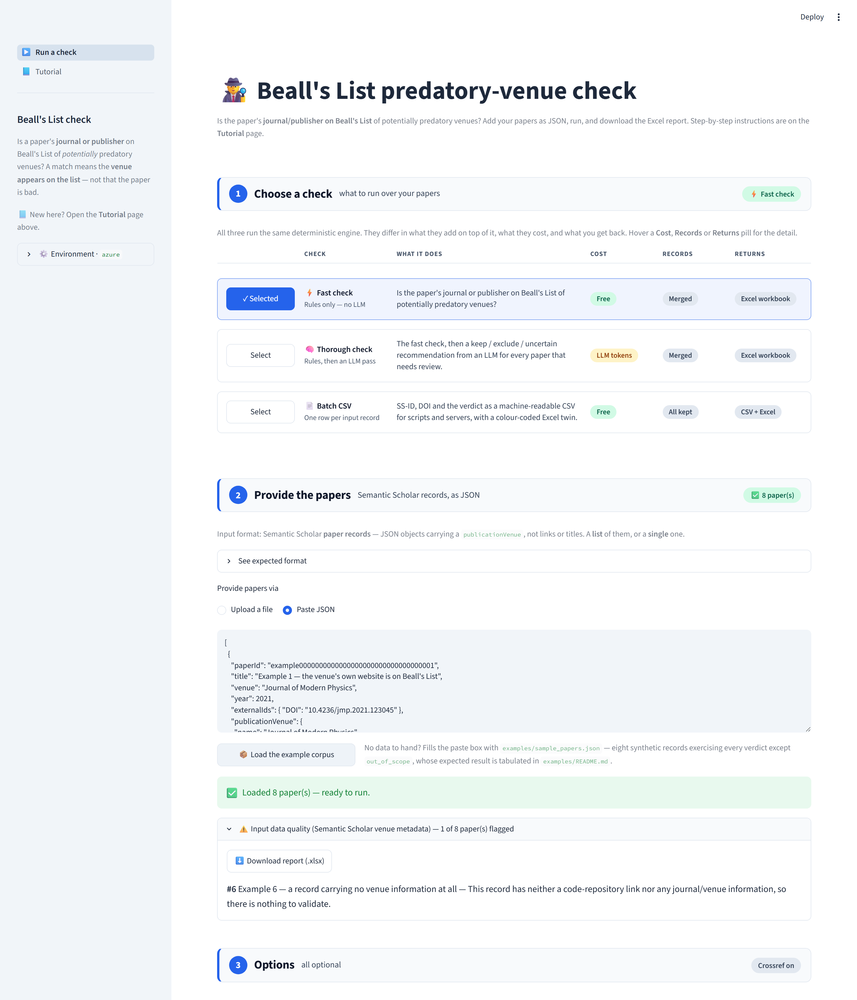

# Beall's List predatory-venue check

A small, transparent tool that screens a batch of research papers and tells you
**which were published in a journal or by a publisher on
[Beall's List](https://beallslist.net)** — the best-known (if unofficial and
contested) catalogue of *"predatory"* academic venues. Checking 500 journals by
hand takes hours; this does it in a single run and hands you a colour-coded Excel
report you can audit line by line.

> [!IMPORTANT]
> **A match means one thing: *"this venue appears on Beall's List."*** It does NOT
> mean the paper is bad or fraudulent — the tool judges the **venue**, never the
> paper. Beall's List is unofficial, archived, and contested (some listed venues,
> e.g. *Frontiers*, are widely regarded as legitimate), so a match is an
> **allegation as of the snapshot date**, not proof. Uncertain matches are flagged
> for a human, never asserted.

> **Working in the code?** [ARCHITECTURE.md](ARCHITECTURE.md) maps every module and
> the data flow.

## Features

- **Deterministic venue matching** — website / ISSN / name / fuzzy, strongest
  signal first; no AI required. → [`match/`](src/bealls_list_check/match/README.md)
- **DOI resolution via Crossref** — settles the uncertain `review` verdicts and
  names the real journal for merged-venue records, using the paper's DOI. On by
  default; falls back to offline automatically. → [`resolve/`](src/bealls_list_check/resolve/README.md)
- **Whitelist / blacklist** — narrow the scope, or add your own predatory venues.
  → [`user_lists/`](src/bealls_list_check/user_lists/README.md)
- **Input data-quality checks** — flag unreliable Semantic Scholar records
  (missing/merged venue, malformed DOI/ISSN, encoding artifacts) on a dedicated
  sheet.
- **Colour-coded Excel report** — every decision carries its evidence; the
  workbook's **Legend** sheet documents every column and value.
- **Optional LLM pass** — a keep/exclude recommendation for every distinct
  `review` **venue** (`bealls_llm_check.py`); it never overrides a deterministic
  verdict.
- **Batch CSV mode for server integration** — one command: a `.jsonl` of Semantic
  Scholar records in, a `SS-ID, DOI, Status` CSV out. The input and output
  structures are documented in full.
  → [`batch_check/`](src/bealls_list_check/batch_check/README.md)
- **Web app** — the same engine in the browser: three checks, up-front input
  validation, colour-coded previews and downloads.
  → [`ui/`](ui/README.md)

## How it works

A run is a short, linear pipeline; each stage is one module, passing a single
*result dictionary* per paper:

```
load snapshot ─▶ match venue ─▶ resolve 'review' via DOI ─▶ check data quality ─▶ render Excel
```

| Stage | Module(s) | Detail |
|---|---|---|
| Load the vendored Beall's List snapshot | `config.py`, `match/` | — |
| Match the venue (strongest signal first) | `match/` | [match/README.md](src/bealls_list_check/match/README.md) |
| Resolve `review` verdicts via the DOI (Crossref) | `resolve/`, `data_quality.py` | [resolve/README.md](src/bealls_list_check/resolve/README.md) |
| Flag unreliable input | `data_quality.py`, `common/input_quality.py` | — |
| Render the Excel workbook | `report.py` | — |

The conductor (`bealls_list_check.py`) wires the stages together; the web app
([`ui/`](ui/README.md)) and the CLI run the same code. See
[ARCHITECTURE.md](ARCHITECTURE.md) for the full map.

## Getting started

Three steps: **set up once, add your papers, run.**

### Before you start

- **Python 3.9 or newer** (developed and tested on 3.11), available as `python`
  on Windows or `python3` on macOS/Linux.
- **An internet connection for setup only** — six packages are installed from
  PyPI. The check itself runs offline if you want it to.
- **Windows:** PowerShell blocks unsigned scripts by default. If `.\setup.ps1`
  fails with *"running scripts is disabled on this system"*, either run it as

  ```bash
  powershell -ExecutionPolicy Bypass -File .\setup.ps1
  ```

  or allow local scripts once, for your user only:

  ```bash
  Set-ExecutionPolicy -Scope CurrentUser RemoteSigned
  ```

### Step 1 · Set up (once)

```powershell
.\setup.ps1        # Windows PowerShell   (macOS/Linux: bash ./setup.sh)
```

Creates a `.venv`, installs [`requirements.txt`](requirements.txt), and copies
[`.env.example`](.env.example) to `.env`. **No API keys are needed** for the fast
check, the data-quality checks, or Crossref — only the optional LLM pass needs a
key (see *[The thorough check](#the-thorough-check--llm-setup)*). `run_ui` uses
this `.venv`, so do this first. Re-running the script is safe: the `.venv` is
reused and an existing `.env` is never overwritten.

### Step 2 · Add your papers

Input is a JSON list of **Semantic Scholar records**; the venue fields
(`publicationVenue.url` / `issn` / `name`, plus `externalIds.DOI`) drive the check
— see [`match/`](src/bealls_list_check/match/README.md) for how each is used. For
the command line, papers live in `docs/Updated Abstract Papers/*.json` by default
(not part of this repo), or point elsewhere:

```bash
export BEALLS_CORPUS_DIR=/path/to/my/papers    # PowerShell: $env:BEALLS_CORPUS_DIR = "C:\path"
```

Every `*.json` file **directly inside** that folder is read and merged into one
run (sub-folders are ignored), and records repeated across files are counted once
— they are deduplicated on `paperId`, falling back to `title`.

**No papers to hand?** [`examples/sample_papers.json`](examples/sample_papers.json)
is an eight-record corpus that exercises every verdict the tool can reach without
a whitelist — use it to confirm the installation works and to see each rule in
action. Its expected output is tabulated in [`examples/`](examples/README.md).

> Using the **web app** (Step 3)? You upload or paste the papers there — skip this step.

### Step 3 · Run the check

#### The web app (easiest)

```powershell
.\run_ui.ps1       # macOS/Linux: bash ./run_ui.sh
```

Open the URL the launcher prints — `http://localhost:8501` unless that port is
already taken, in which case Streamlit picks the next free one.

The app has two pages, listed in its sidebar. **Run a check** is the four-step
flow summarised below; **Tutorial** is a guided path from installation to a first
verified run against the bundled example corpus, whose expected result is
published — the fastest way to learn the app and to confirm that the
installation works. It renders [`ui/TUTORIAL.md`](ui/TUTORIAL.md), which is
equally readable here on GitHub.



Every step carries a header bar — a numbered badge, the title, and a pill naming
that step's live answer — so a page scrolled halfway still states what pressing
**Run check** would do.

**Step 1 · Choose a check.** The three are laid out as a comparison table — one
row each, one column per attribute they differ on — so that they can be weighed
against each other before one is selected:

| Check | What it does | Cost | Records | Returns |
|---|---|---|---|---|
| **Fast check** | Rules only — the deterministic match. | free | merged | Excel workbook |
| **Thorough check** | The fast check, then one LLM call per distinct `review` **venue**. | tokens; keys required | merged | Excel workbook |
| **Batch CSV** | `SS-ID, DOI, Status` per record, for scripts and servers. | free | all kept | CSV + Excel |

*Merged* means a paper repeated in the corpus is reported once — deduplicated on
`paperId`, falling back to the title. *All kept* means one CSV row per record
supplied, in the order supplied. In the app, each of those cells is a pill whose
hover text carries the detail.

**Step 2 · Provide the papers.** Drop a `.json` file on the upload box — a list
of Semantic Scholar records, or a single record — or paste the JSON directly.
(`.jsonl` is not accepted here; convert it to an array, or use the batch command
line.) **📦 Load the example corpus** below the box fills the paste area with the
bundled [example corpus](examples/README.md), for trying the app without
supplying data. An **Input data quality** panel appears as soon as the papers
load: an offline check of the metadata *before* anything runs, downloadable as
`input_data_quality.xlsx`.

**Step 3 · Options.** One checkbox controls **Crossref**; clearing it is
equivalent to `--crossref off`. Under **Advanced**, a whitelist (*only check
these venues*) and a blacklist (*also treat these venues as predatory*) are
pasted as JSON rather than passed as file paths, and apply to the Fast and
Thorough checks only — Batch CSV classifies every record.

**Step 4 · Run.** A labelled summary restates what is about to run — the check,
how many papers, Crossref, the two lists, and what comes back — and the button
stays disabled until papers are loaded. A workbook result is followed by **Also
produce the batch CSV**, which adds the machine-readable file without a second
trip through Step 1 — it re-runs the deterministic pass, because the CSV keeps
every input record while the workbook is deduplicated.

> [!WARNING]
> The **Thorough** check in the browser assesses *every* distinct `review` venue
> — there is no `--limit` in the UI. For a capped trial run, use
> `bealls_llm_check.py --limit 50` on the command line.

The full walkthrough — every control, both downloads, and how the app differs
from the CLI — is in [`ui/README.md`](ui/README.md).

#### The command line

Activate the environment first (`.\.venv\Scripts\Activate.ps1`, or
`source .venv/bin/activate`):

```bash
python src/bealls_list_check/bealls_list_check.py            # fast check
python src/bealls_list_check/bealls_llm_check.py --limit 50  # optional LLM pass (cheap test)

# narrow the scope, or add your own predatory venues (both take a JSON file —
# see user_lists/README.md for the format)
python src/bealls_list_check/bealls_list_check.py --whitelist wl.json --blacklist bl.json

# batch mode: JSONL in, CSV (SS-ID, DOI, Status) out — for scripts/servers
python src/bealls_list_check/batch_check/batch_check.py papers.jsonl -o results.csv
```

The fast check uses **Crossref by default** when online and falls back to fully
offline automatically; add `--crossref off` to force offline, or `--crossref
flagged` to limit it to flagged papers. Crossref is what makes a run slow: fully
offline it takes seconds, while the default contacts Crossref once per distinct
DOI, which turns a few hundred papers into minutes. Setting `CROSSREF_MAILTO` in
`.env` puts those lookups in Crossref's faster "polite pool" — recommended for
large runs.

> `batch_check.py` takes `--crossref on|off` only — `flagged` is not accepted
> there. It also has no whitelist/blacklist, so its output has five statuses, not
> six (`out_of_scope` cannot occur).

### The thorough check — LLM setup

Only this pass needs credentials. Six providers are supported via `LLM_PROVIDER`
in `.env`; **`azure` is the default, and its key and endpoint ship empty**, so
the thorough check will not run until you fill them in (or switch provider).

| `LLM_PROVIDER` | What you must set in `.env` |
|---|---|
| `azure` *(default)* | `OPENAI_KEY`, `AZURE_OPENAI_ENDPOINT`, `AZURE_OPENAI_API_VERSION` |
| `openai` | `OPENAI_API_KEY` |
| `anthropic` | `ANTHROPIC_API_KEY` |
| `mistral` | `MISTRAL_API_KEY` |
| `gemini` | `GEMINI_API_KEY` |
| `ollama` | nothing — a local server, so no key and no cost |

The **model name goes in `AZURE_OPENAI_DEPLOYMENT` for every provider**, not just
Azure (e.g. `AZURE_OPENAI_DEPLOYMENT=claude-3-5-sonnet-20241022`). The name is
historical; see [`.env.example`](.env.example) for a worked example per provider.

Cost scales with the number of **distinct `review` venues**, not papers: the pass
groups the `review` rows by venue, makes one call per group, and copies the
verdict to every paper in it. `--limit 50` therefore means *50 venues*. The run
prints how many venues it will assess before starting, and a token-usage report
at the end (tokens only — no monetary estimate). A missing key is caught *before*
the long deterministic pass, with a message naming the exact `.env` lines to fill.

The pass writes a **second workbook**, `bealls_llm_results.xlsx`; it does not
touch the fast check's file. Its recommendation appears as an **"LLM review"**
column on the *Flagged only* sheet, with three values: *Predatory — recommend
EXCLUDE*, *Legitimate — recommend KEEP*, and *Uncertain — check by hand*.

## Output

### The six verdicts

Every paper gets exactly one **status**, colour-coded in the report:

| Status | Colour | Meaning |
|---|---|---|
| `on_list` | 🔴 red | **Strong match:** the venue's own website, an exact ISSN, or an exact name that the paper's own website corroborates (or that the listed entry records no website to contradict), on a *core* list. Read as *"appears on Beall's List."* |
| `review` | 🟠 orange | **Weak / uncertain match** a human should double-check. Not a confident accusation. |
| `clean` | 🟢 green | The venue was identified and is **not** on the list. |
| `no_venue` | ⚪ grey | A preprint or a record with no venue — nothing to check. |
| `out_of_scope` | 🔵 blue | *Only with a whitelist:* the venue wasn't in it, so it was skipped. |
| `error` | ⚫ dark | The record couldn't be processed (the reason is shown in the row). |

The ***core* lists** are predatory *publishers*, standalone *journals*, and
*hijacked* journals — plus any venues you add via `--blacklist`. The two
remaining lists are deliberately weaker: a match against *fake-metrics* companies
or *vanity presses* is **always** downgraded to `review`, never asserted as
`on_list`, because neither is a predatory-journal signal.

### The workbook

Written to **`src/bealls_list_check/results/bealls_list_results.xlsx`** (the LLM
pass writes `bealls_llm_results.xlsx` alongside it). The folder is created on
first run and is not tracked by git. **Each run replaces the previous file** — if
it is open in Excel and therefore locked, the run saves to
`bealls_list_results_YYYYMMDD_HHMMSS.xlsx` instead and says so, so no run is ever
lost.

| Sheet | Contents |
|---|---|
| **Results** | Every paper, in corpus order, coloured by status, with the full evidence behind its verdict. |
| **Flagged only** | Just the `on_list` and `review` rows, re-sorted `on_list` first — so you are not scrolling past thousands of clean rows. The LLM pass adds its column here. |
| **Data quality** | Only the papers whose record warranted a warning (see below). **Omitted entirely when nothing was flagged.** |
| **Summary** | Counts per status, per match signal and per Beall list, plus the run metadata — snapshot date and size, corpus files, run time. |
| **Legend** | A plain-language data dictionary for every column and value. |

Note that **each paper occupies a four-row merged block**, not a single row, under
a two-row header — taller still when *Mentioned in* lists several venues. Sort
and filter accordingly; the row count is not the paper count.

### Reading the Data-quality sheet

It collects everything that should make you trust a verdict less. Offline, that
is: no title; no venue information at all; a malformed DOI or ISSN; leftover HTML
character codes in a field; and a *merged venue* — a Semantic Scholar record that
has fused several publishers into one entry. With Crossref enabled it adds: the
DOI was not found in the registry, the venue name disagrees with Crossref's
record, and the ISSN disagrees with it.

Two things surprise first-time readers:

- **The sheet is absent when nothing was flagged.** That is a clean result, not a
  bug.
- **`clean` and `on_list` papers appear here too.** The DOI resolution step writes
  its audit trail to the same field, so a paper that Crossref *cleared* or
  *confirmed* is listed with the explanation of why.

## Key terms

| Term | Plain-language meaning |
|---|---|
| **Predatory journal/publisher** | A venue that takes authors' money but does not provide real peer review. |
| **Beall's List** | A catalogue of *alleged* predatory venues, hosted unofficially at beallslist.net. It is **five lists**: predatory *publishers*, standalone *journals*, *hijacked* (cloned) journals, *fake-metrics* companies, and *vanity presses*. |
| **Venue** | The journal, publisher, or conference a paper was published in. This tool checks the venue, not the paper. |
| **DOI / ISSN** | Permanent identifiers for an article (`10.1234/x`) and a journal (`NNNN-NNNX`). |
| **Preprint** | A paper on arXiv, bioRxiv, etc. — no journal publisher, so it can't be "on Beall's List." |
| **Snapshot** | The local, dated copy of Beall's List the tool matches against — reproducible and offline. |
| **Fuzzy match** | A venue name at least **93%** similar to a listed name but not identical — a spelling variant or typo. Only tried against the core lists, and it can only ever produce `review`. |
| **Crossref** | The official registry publishers deposit articles into. Queried **by DOI** (as an API — never opening the DOI link or the journal's page) to double-check metadata and resolve uncertain matches. On by default, with an offline fallback. |

## Refreshing the snapshot

The tool matches a **vendored snapshot**
([`data/bealls_snapshot.json`](src/bealls_list_check/data/bealls_snapshot.json),
**~3,045 entries** — 1,335 publishers, 1,501 journals, 139 hijacked, 55
fake-metrics, 15 vanity — **scraped 2026-06-10**) so runs are reproducible and
work offline. Rebuild it from the live site with:

```bash
python src/bealls_list_check/scrape_bealls_list/scrape_bealls_list.py
```

> [!CAUTION]
> The scraper **overwrites the snapshot in place** — there is no backup and no
> `--out` flag, and the path is not configurable. Since the file is tracked by
> git, `git checkout` on it restores the previous copy; commit the refresh
> deliberately, because every earlier report was produced against the old one.

See [`scrape_bealls_list/`](src/bealls_list_check/scrape_bealls_list/README.md)
for exactly what it fetches and the traps it avoids.

## Limitations and responsible use

- **Beall's List is unofficial, archived, and contested.** A match is an
  allegation as of the snapshot date — not proof a venue is predatory.
- **This tool classifies the *venue*, not the *paper*.** It says nothing about a
  paper's correctness, quality, or its authors' integrity.
- **`on_list` means "appears on the list," not "is predatory."** Treat it as a
  prompt to look closer.
- **`review` always needs a human.** It exists precisely because the match is
  uncertain.
- **The fast check uses no LLM** and is fully deterministic and auditable from the
  *Match* column. The optional LLM pass only *adds* recommendations.
- **Garbage in, garbage out.** Verdicts are only as good as Semantic Scholar's
  metadata — which is why the Data-quality sheet exists and Crossref
  cross-checking runs by default.
- **Some hits are missed by design.** Venues whose only web presence is a shared
  platform (Google Sites, WordPress) or a large national aggregator (DergiPark,
  J-STAGE, SciELO) are excluded from website matching, so that one listed journal
  cannot flag every co-hosted legitimate one. Such venues can still match by name.
- **A long run reports little while it works.** The deterministic pass prints one
  line per corpus file *after* that file is fully processed, so a large run with
  Crossref enabled can appear silent for minutes. It is not stuck.
- **Crossref failures degrade the run rather than stop it.** After three
  consecutive failed lookups the run warns and skips all remaining DOI checks, so
  a report can be partly resolved; and an LLM API error mid-pass ends that run
  without a workbook, after the tokens spent so far.
- **What leaves your machine:** DOIs go to Crossref, and venue names, domains and
  ISSNs go to your LLM provider on the thorough check. Paper titles and abstracts
  are never sent anywhere.
