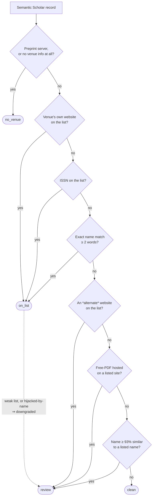

# Beall's List predatory-venue check

A small, transparent tool that takes a batch of research papers and tells you
**which ones were published in a journal or by a publisher that appears on
[Beall's List](https://beallslist.net)** — the best-known (if unofficial and
contested) catalogue of *"predatory"* academic venues.

It is built for one job: screening a large reading list quickly. Checking 500
journals by hand takes hours; this tool does it in seconds and hands you a
colour-coded Excel report you can audit line by line.

---

## Table of contents

1. [What this tool does — and what it does *not* do](#1-what-this-tool-does--and-what-it-does-not-do)
2. [Key terms (read this if any word below is new to you)](#2-key-terms-read-this-if-any-word-below-is-new-to-you)
3. [Quick start: the web app](#3-quick-start-the-web-app)
4. [The input: Semantic Scholar paper records](#4-the-input-semantic-scholar-paper-records)
5. [**How the check decides — step by step**](#5-how-the-check-decides--step-by-step)
6. [The six verdicts](#6-the-six-verdicts)
7. [How to read the Excel report](#7-how-to-read-the-excel-report)
8. [First-time setup](#8-first-time-setup)
9. [Running from the command line](#9-running-from-the-command-line)
10. [Whitelist and blacklist (optional)](#10-whitelist-and-blacklist-optional)
11. [Data-quality checks (catching unreliable input)](#11-data-quality-checks-catching-unreliable-input)
12. [The thorough check (an LLM to resolve the `review` papers)](#12-the-thorough-check-an-llm-to-resolve-the-review-papers)
13. [Refreshing the Beall's List snapshot](#13-refreshing-the-bealls-list-snapshot)
14. [Project structure](#14-project-structure)
15. [Limitations and responsible use](#15-limitations-and-responsible-use)

---

## 1. What this tool does — and what it does *not* do

**The problem.** Some academic journals are *predatory*: they charge authors a
publication fee but provide little or no genuine peer review. A widely-cited
attempt to catalogue such venues is **Beall's List**. If you are compiling a
literature survey, you may want to know — fast — whether any of your sources come
from a venue on that list, so you can give those a closer look.

**What the tool does.** For each paper you give it, it looks **only at the
publication venue** (the journal or publisher), normalises it, and compares it
against a local copy of Beall's List. It then labels each paper with one of six
verdicts (see [§6](#6-the-six-verdicts)) and writes everything to an Excel
workbook with the evidence for every decision.

> [!IMPORTANT]
> **A match means one specific thing: *"this venue appears on Beall's List."*
> It does NOT mean the paper is bad, wrong, or fraudulent.**
>
> - The tool judges the **venue**, never the **paper's content or quality**.
> - Beall's List is **unofficial, archived, and contested**. The original list
>   was taken down in 2017; [beallslist.net](https://beallslist.net) is an
>   anonymous continuation. Some venues on it (e.g. *Frontiers*) are widely
>   regarded as legitimate. So "appears on the list" is an **allegation as of the
>   snapshot date**, not proof.
> - Uncertain matches are **flagged for a human to verify**, never asserted.

**No AI is required.** The default ("fast") check uses **no LLM at all** — every
verdict is produced by deterministic rules and is fully traceable from the
report. There is an *optional* "thorough" mode that adds an LLM opinion to help
you resolve the genuinely uncertain cases (see [§12](#12-the-thorough-check-an-llm-to-resolve-the-review-papers)).

---

## 2. Key terms (read this if any word below is new to you)

| Term | Plain-language meaning |
|---|---|
| **Predatory journal/publisher** | A venue that takes authors' money but does not provide the real peer review a legitimate journal would. |
| **Beall's List** | A catalogue of *alleged* predatory publishers and journals, originally compiled by librarian Jeffrey Beall. Now hosted unofficially at beallslist.net. It is **five lists**: predatory *publishers*, standalone predatory *journals*, *hijacked* (cloned) journals, *fake-metrics* companies, and *vanity presses* (book publishers). |
| **Venue** | The journal, publisher, or conference a paper was published in. This tool checks the venue, not the paper. |
| **Semantic Scholar** | A free academic search engine and database ([semanticscholar.org](https://www.semanticscholar.org/)). Its records describe each paper *and its venue* in a structured form — that structured record is this tool's input. |
| **`publicationVenue`** | The part of a Semantic Scholar record that describes the venue: its name, website, ISSN, and so on. This is the most important field for the check. |
| **DOI** | *Digital Object Identifier* — a permanent ID for a published article, e.g. `10.1234/x`. It resolves to the article's page at the publisher. |
| **ISSN** | *International Standard Serial Number* — an 8-digit ID for a journal, written `NNNN-NNNX`. |
| **Preprint** | A paper posted to a server such as arXiv or bioRxiv **before** (or instead of) journal publication. A preprint has no journal publisher, so it cannot be "on Beall's List." |
| **Snapshot** | The local, dated copy of Beall's List this tool matches against. Stored in the repo so runs are reproducible and work offline. |
| **Fuzzy match** | A "close but not identical" text match (e.g. a typo'd journal name). Used cautiously, and only ever produces a *review* verdict. |
| **Crossref** | The official registry that publishers deposit their articles into ([crossref.org](https://www.crossref.org/)). Used optionally to double-check Semantic Scholar's metadata. |

---

## 3. Quick start: the web app

The fastest way to try the tool. From the project folder:

```powershell
.\run_ui.ps1          # Windows PowerShell
```
```bash
bash ./run_ui.sh      # macOS / Linux
```

This opens a page in your browser at **`http://localhost:8501`**. There you:

1. **Choose** the *fast* (rules-only) or *thorough* (rules + LLM) check.
2. **Provide** your papers — paste JSON or upload a `.json` file (see
   [§4](#4-the-input-semantic-scholar-paper-records)).
3. Press **Run**, then **preview and download** the Excel report.

As soon as your papers load, an **Input data quality** panel flags any records
that look unreliable. The web app runs the *same code* as the command line, so
the output is identical.

> First time? Run [`setup.ps1` / `setup.sh`](#8-first-time-setup) once before
> `run_ui`.

---

## 4. The input: Semantic Scholar paper records

The tool's input is **one JSON list of paper records, in exactly the shape
[Semantic Scholar](https://www.semanticscholar.org/) returns them.** You can
obtain these from the Semantic Scholar Academic Graph API or its bulk datasets;
the tool reads the records as-is. Each record describes a paper and, crucially,
the venue it was published in.

A minimal record looks like this:

```json
{
  "title": "Example paper",
  "venue": "Journal of X",
  "year": 2023,
  "externalIds": { "DOI": "10.1234/x" },
  "publicationVenue": {
    "name": "Journal of X",
    "type": "journal",
    "url": "https://www.scirp.org/journal/x",
    "issn": "1234-5678",
    "alternate_urls": [],
    "alternate_names": []
  },
  "openAccessPdf": { "url": "" }
}
```

### Which fields the check reads, and what each one is used for

You do not have to provide every field — the more you provide, the more signals
the check has. Here is exactly how each field is used:

| Field | Role in the check |
|---|---|
| `publicationVenue.url` | **The single strongest signal.** The venue's own website. An exact (or sub-page) match to a listed site is a high-confidence hit. |
| `publicationVenue.alternate_urls` | Other websites Semantic Scholar associates with the venue. Trusted **less** than the main URL (see why in [§5](#5-how-the-check-decides--step-by-step)) — a match here is *review only*. |
| `publicationVenue.issn` | The journal's ISSN. An exact ISSN match is a high-confidence hit. |
| `venue`, `publicationVenue.name`, `publicationVenue.alternate_names` | All the **names** the venue is known by. Used for exact-name and fuzzy-name matching. (The *Mentioned in* column shows the venue(s) that also have a URL — see [§7](#7-how-to-read-the-excel-report).) |
| `publicationVenue.type` | `journal` / `conference` / etc. — shown for context. |
| `externalIds.DOI` | Builds the clickable link to the article, and is the key for the optional Crossref cross-check. |
| `openAccessPdf.url` | The host of the free PDF. A *weak* signal — if the PDF lives on a listed publisher's server it earns a *review*, never an automatic hit. |
| `title`, `year`, `paperId` | Shown in the report; `paperId` also de-duplicates papers across files. |

You can paste/upload this in the web app, or place one or more such JSON files
in a folder and point the command-line check at it (see
[§9](#9-running-from-the-command-line)).

---

## 5. How the check decides — step by step

This is the heart of the tool. Everything here is **deterministic**: the same
input always gives the same verdict, and the report shows you *why*. The logic
lives in [`match.py`](src/bealls_list_check/match.py) and
[`config.py`](src/bealls_list_check/config.py).

### The guiding principle

> Signals are tried **strongest-first, and the first one that matches wins.**
> A *website* or *ISSN* match is treated as solid evidence; a *name* match is
> weaker (names are ambiguous); a *fuzzy* name match is weakest. Nothing
> uncertain is ever asserted — it is downgraded to `review` for a human.

### The decision flow



### The same flow, spelled out precisely

**Step A — Gather the venue signals from the record.**
The check extracts: the *canonical website* (host of `publicationVenue.url`), any
*alternate websites* (`alternate_urls`), every *name* (`venue` +
`publicationVenue.name` + `alternate_names`, normalised), the *ISSN*, and the
*free-PDF host* (`openAccessPdf.url`).

**Step B — Is there anything to check? → `no_venue`.**
- If the venue is a known **preprint server** (arXiv, bioRxiv, medRxiv, SSRN,
  OSF, ResearchSquare, …) the paper has no journal publisher → `no_venue`.
- If there is **no website, no name, and no ISSN** → `no_venue`.

**Step C — Strong signals → `on_list` (high confidence).** Tried in this exact
order; the first hit wins:
1. **Canonical website** equals a listed site, *or* is a sub-page of one
   (e.g. `ojs.bilpublishing.com` sits under the listed `bilpublishing.com`).
2. **ISSN** exactly equals a listed journal's ISSN.
3. **Exact name** — a venue name (at least **2 words** and **5 letters**)
   exactly equals a listed name. Capitalisation, accents, and punctuation are
   ignored, so `MDPI AG`, `mdpi`, and `https://www.mdpi.com/` all normalise to
   the same key. (The ≥ 2-word rule stops generic single words like *"Research"*
   from colliding with legitimate journals.)

**Step D — Soft signals → `review` (a human should verify).** Only reached if
nothing in Step C matched:
4. One of the **alternate websites** matches a listed site (the report lists
   *all* such candidates, not just the first).
5. The **free PDF** is hosted on a listed site, even though the venue itself was
   not identified as listed. (Like the alternate-URL case, this is then resolved
   by the paper's DOI when it has one — see below.)
6. A venue name is **≥ 93% similar** (but not identical) to a listed name — a
   spelling variant or typo.

**Step E — Nothing matched → `clean`.** The venue was identified and is not on
the list.

### Three deliberate downgrades from `on_list` to `review`

Even a Step-C "strong" match is downgraded to `review` in three cases, because
treating them as confident hits would be misleading:

- **Weak lists.** A match against the *vanity-press* list (book/monograph
  publishers such as IGI Global) or the *fake-metrics* list (companies selling
  invented impact factors) is **never** `on_list`. Those are not predatory-
  *journal* signals, so they are surfaced for a human but not asserted.
- **Hijacked journals, matched by name.** A *hijacked* (cloned) journal reuses
  the **real** journal's name to impersonate it. So an exact-*name* match to a
  hijacked entry might actually be the **legitimate** journal — it is downgraded
  to `review`. Only a *website* or *ISSN* match (the clone's own identity) is
  asserted as `on_list`. Such a `review` is then **cleared to `clean`** only on
  *positive proof that the paper is the genuine journal* — its venue is the
  authentic journal's own site (from Beall's "authentic journal" column), or its
  DOI resolves via Crossref to that **same authentic site**. It is **not** cleared
  on the weaker "the DOI's publisher merely isn't the counterfeit and isn't
  listed" signal: a clone that registered DOIs under an unrecorded domain, or a
  *different* legitimate journal that happens to share the name, would slip
  through that. Anything short of a match to the authentic site stays `review`.
  The clearance and its reason are kept on the Data-quality sheet.
- **Exact-name match the website doesn't back up.** A name alone is
  high-confidence only if the paper's own venue is hosted at the *same site* as
  the Beall entry. If the listed venue has a website but **none** of the paper's
  URLs are that site, the name may just be a coincidence — many journals share a
  name (e.g. a paper at `virginiaresearchinstitute.com` whose title matches the
  listed *International Journal for Multidisciplinary Research* at `ijfmr.com`,
  or a Wiley article mislabeled as *Revista de educación*). The exact-*name* hit
  is downgraded to `review`; *website* and *ISSN* matches are left untouched.
  This `review` is then resolved by the paper's DOI (when `--crossref` is on):
  Crossref tells which journal the DOI is actually registered to, matched **by
  publisher website or ISSN only — never by the shared name**. If it's the listed
  journal → `on_list`; if it's the paper's own, unlisted venue → `clean`;
  otherwise it stays `review`.

### Why the canonical website is trusted but alternate URLs are not

Semantic Scholar sometimes **merges two different journals that happen to share a
name** into one venue record. When it does, the `alternate_urls` may point at an
*unrelated* publisher — e.g. a legitimate Elsevier journal whose record also
carries a predatory clone's link. To stay truthful, the check trusts the
**canonical** `publicationVenue.url` (asserts `on_list`) but treats an
**alternate-only** match as `review`, so a human can confirm which journal it
really belongs to.

That `review` is then **resolved automatically when the paper has a DOI**, since
the DOI is the authoritative record of which journal this *specific* paper was
published in. The DOI is looked up in Crossref and compared with the flagged
alternate by ISSN, publisher website, or exact journal name:

- if it **matches** the listed alternate, the alternate really is this paper's
  venue → promoted to `on_list` (still subject to the weak-list / hijacked-name
  downgrades above);
- if it **positively identifies the paper's own canonical venue** (by ISSN,
  website, or exact name) and that venue is not on the list, the alternate was
  merge noise belonging to a different same-named journal → **cleared to
  `clean`**;
- **anything else stays `review`** — no DOI, no Crossref record, or any result
  that does *not* positively identify the canonical venue. In particular, the
  check **never clears on the weak signal "the real publisher merely isn't
  listed"**: a predatory publisher Beall recorded under a *different* domain
  would slip through that test, so when in doubt the paper is left for a human. A
  false clear is the one error this check must not make.

The **free-PDF** review (signal 5 above) is resolved the same way. A PDF hosted
on a listed site is only suggestive — it can be re-hosted by someone other than
the publisher — so the DOI decides: if Crossref says the paper was **published**
by that listed site, it is promoted to `on_list`; if the DOI **positively
identifies the paper's own, unlisted venue**, the PDF was merely re-hosted and it
is **cleared to `clean`**; anything less stays `review`. The same positive-proof
rule applies — it is never cleared just because the real publisher isn't listed.

The promotion or clearance and its reason are kept on the Data-quality sheet.

### Built-in safeguards against false positives

- **Only real listed hosts are ever match keys**, compared longest-suffix first.
  A paper hosted at `jurnal.unimed.ac.id` can therefore **never** collapse onto a
  public suffix like `ac.id` — that whole class of false positives is impossible
  by construction.
- **Shared platforms are excluded from website matching.** Generic hosts
  (Google Sites, WordPress.com, Blogspot, …) and large *national aggregators*
  that host thousands of legitimate journals (**DergiPark** in Turkey,
  **J-STAGE** in Japan, **SciELO** in Brazil) are removed from the website index.
  Otherwise one listed journal on such a platform would wrongly flag every
  co-hosted journal. (A genuinely-listed venue on them can still match by name.)
- **Fuzzy matching is deliberately strict** (93% similarity), only runs against
  the three *core* lists, and **can only ever yield `review`** — never a
  confident hit.
- **Preprint detection looks only at the venue**, never at the free-PDF host
  (published papers routinely also have an arXiv PDF).

---

## 6. The six verdicts

Every paper gets exactly one **status**, and rows in the Excel report are
colour-coded by it:

| Status | Colour | Meaning |
|---|---|---|
| `on_list` | 🔴 red | **Strong match:** the venue's own website, exact ISSN, or exact name is on a *core* Beall list. Read as *"appears on Beall's List."* |
| `review` | 🟠 orange | **Weak / uncertain match** a human should double-check (similar name, alternate URL, free-PDF host, hijacked-by-name, or a weak list). Not a confident accusation. |
| `clean` | 🟢 green | The venue was identified and is **not** on the list. |
| `no_venue` | ⚪ grey | A preprint (e.g. arXiv) or a record with no venue — nothing to check. |
| `out_of_scope` | 🔵 blue | *Only when a whitelist is supplied:* the paper's venue wasn't in it, so it was skipped. |
| `error` | ⚫ dark | The record couldn't be processed (the reason is shown in the row). |

---

## 7. How to read the Excel report

The fast check writes
[`src/bealls_list_check/results/bealls_list_results.xlsx`](src/bealls_list_check/results/).
It has several sheets; the two you'll use most are **Results** (every paper) and
**Flagged only** (just the `on_list` + `review` papers).

Each paper is shown as a **block of rows** so every detail gets its own line:

| Column | What's in it |
|---|---|
| **#** | The paper's number (spans the whole block). |
| **Status** | The verdict from [§6](#6-the-six-verdicts), colour-coded (spans the whole block). |
| **Paper specifications** | A header grouping the next three columns — everything describing the paper itself: |
| &nbsp;&nbsp;• Paper | Title / Year / Source file / DOI (the DOI is a clickable link to the article). |
| &nbsp;&nbsp;• Semantic Scholar venue | The venue exactly as Semantic Scholar reports it: name / type / website / ISSN. |
| &nbsp;&nbsp;• Mentioned in | Each venue tied to the paper **that has a web link**, showing the venue **name** and hyperlinked to the **venue's own site** (the type — journal/conference — isn't repeated here; it's in the venue column's `Type` field). Venues with no link are omitted (so this can be `—`); there's one entry per distinct venue URL (each disambiguated by its host), so a merged-venue record shows every site it points at. This is the only column that can grow: a paper with 6 linked venues makes a 6-row block, while the other columns keep their fields (merged to fill). |
| **Match** | *Why* it was flagged: **Listed as** (the matching Beall entry, a link), **Beall list** (which of the five lists it came from), and **Why flagged** (one plain sentence: how it matched and what that means). |

Other sheets: **Data quality** (only papers whose Semantic Scholar record looks
unreliable, each with the specific issue — see
[§11](#11-data-quality-checks-catching-unreliable-input)), **Summary** (totals +
run metadata), and **Legend** (a full plain-language dictionary of every column
and value). The thorough check adds an **LLM review** column to the *Flagged
only* sheet.

### A worked example

Take a plant-ecology paper whose venue Semantic Scholar reports as `Phyton`. The
name `Phyton` matches a **hijacked / cloned journal** entry on Beall's List — a
predatory site (`engineeronline.net`) once impersonated a real journal called
*Phyton: Annales Rei Botanicae* (the authentic one is at `verlag-berger.at`) by
copying its name. A name match alone can't tell the genuine journal from the
counterfeit, so this starts as a doubtful `review`.

The check then reads the paper's DOI (`10.32604/phyton.2024.050556`) in Crossref,
which shows it was published by **Tech Science Press**. That is *not* the
counterfeit — but it is *not* the recorded authentic journal (`verlag-berger.at`)
either: it is a **third, different journal that merely shares the name "Phyton."**
Because the check cannot *prove* this is the genuine journal it was meant to be,
it does **not** clear the paper — it **stays `review`** for a human (or the LLM
pass) to judge. The tool clears a hijacked-by-name paper to `clean` **only** when
its venue website, or its DOI, points to the **authentic journal's own site**
(here, `verlag-berger.at`) — positive proof it is the genuine journal, not the
clone or some other same-named one. This is deliberate: wrongly clearing a paper
that might be predatory is the one mistake the check must never make, so when the
evidence is anything less than positive, it keeps the paper flagged.

When a paper *is* cleared this way it leaves the *Flagged only* sheet but stays on
the **Data quality** sheet, so the check and its reason remain visible. There,
`clean` means *"not on Beall's List"* — not *"proven reputable."*

---

## 8. First-time setup

Run once:

```powershell
.\setup.ps1           # Windows PowerShell
```
```bash
bash ./setup.sh       # macOS / Linux
```

This creates a private Python environment in `.venv`, installs the libraries from
[`requirements.txt`](requirements.txt), and copies [`.env.example`](.env.example)
to `.env`. The web-app launchers (`run_ui.*`) use that environment automatically.

To run the **command-line** scripts yourself, activate the environment first:

```powershell
.\.venv\Scripts\Activate.ps1     # Windows PowerShell
```
```bash
source .venv/bin/activate         # macOS / Linux
```

> [!NOTE]
> **You only need API keys for the "thorough" check.** The fast check, the
> data-quality checks, and the optional Crossref cross-check need **no keys at
> all**. For the thorough check, set your LLM provider and key in `.env` (see the
> comments in [`.env.example`](.env.example)).

---

## 9. Running from the command line

```bash
# Step 1 (optional): refresh the local copy of Beall's List. A snapshot is
#         already included, so you can normally skip this. (See §13.)
python src/bealls_list_check/scrape_bealls_list.py

# Step 2: the FAST check (rules only, no LLM) — writes the Excel report.
python src/bealls_list_check/bealls_list_check.py

# Optional: the THOROUGH check — fast check + an LLM recommendation for each
#           'review' paper (costs tokens). (See §12.)
python src/bealls_list_check/bealls_llm_check.py
python src/bealls_list_check/bealls_llm_check.py --limit 50   # cheap test
```

### Telling the check where your papers are

By default the check reads its corpus from `docs/Updated Abstract Papers/*.json`
**relative to the project root**. That folder is *not* part of this repository
(the paper data lives outside it), so on a fresh clone you must point the check
at your own folder of Semantic Scholar JSON files:

```powershell
$env:BEALLS_CORPUS_DIR = "C:\path\to\my\papers"   # Windows PowerShell
```
```bash
export BEALLS_CORPUS_DIR=/path/to/my/papers        # macOS / Linux
```

The check globs that folder for `*.json`, so **only** corpus files should live
there. (The web app handles this for you automatically — it writes your uploaded
papers to a temporary folder behind the scenes.)

---

## 10. Whitelist and blacklist (optional)

Tailor a run with two optional inputs (CLI flags, also available in the web app).
Each is a JSON list of `{"name": ..., "domain": ...}` entries (a plain string
works as just a name):

```bash
python src/bealls_list_check/bealls_list_check.py \
    --whitelist whitelist.json --blacklist blacklist.json
```

- **`--whitelist` narrows the scope.** Only papers whose venue matches a
  whitelisted entry are checked; the rest are marked `out_of_scope`. (A paper is
  in scope if its venue domain is, or sits under, a whitelisted domain, or a
  whitelisted name appears as a whole word in one of its venue names.)
- **`--blacklist` extends the list.** Its entries are added to Beall's List for
  this run and matched like real entries, so a paper in one comes back `on_list`.

---

## 11. Data-quality checks (catching unreliable input)

Semantic Scholar's data is sometimes wrong — it occasionally **merges two
journals** that share a name, stores an **out-of-date web address**, or **omits
the venue** entirely. A verdict from bad input is worse than none, so the report
includes a separate **Data quality** sheet listing only the papers whose record
looks suspect, each with the specific issue:

- no venue information at all;
- a malformed DOI or ISSN;
- leftover HTML codes (e.g. `&amp;`) in the venue name;
- a **"merged venue"** — one record pointing at *two different publishers'*
  websites (the classic sign that Semantic Scholar fused two same-named
  journals). For these, the check **looks the paper's DOI up in Crossref
  automatically** and names the journal it was *actually* published in (e.g.
  *"…actually published in Review of Education (ISSN 2049-6613; Wiley)…"*), so you
  don't have to resolve it by hand. (This is the one online step in the otherwise
  offline fast check; it runs only for merged-venue papers that have a DOI.)

Optionally, cross-check against **Crossref** (the official registry publishers
submit their articles to): when enabled, the journal name and ISSN Semantic
Scholar reports are compared with Crossref's record (looked up by the paper's
DOI), and any disagreement is flagged.

```bash
# 'flagged' = only the on_list/review papers (cheap); 'all' = every DOI.
python src/bealls_list_check/bealls_list_check.py --crossref flagged
```

> [!NOTE]
> Appearing on the Data quality sheet means *"double-check this by hand"* — **not**
> that the verdict is wrong. And an empty result is **not** a guarantee the
> record is right; Semantic Scholar can be wrong in ways no automated check sees.

---

## 12. The thorough check (an LLM to resolve the `review` papers)

The fast check is precise, but `review` papers are by definition uncertain, and
going through them by hand is slow. The thorough check asks an LLM for a concrete
recommendation on **each `review` paper — and only those:**

```bash
python src/bealls_list_check/bealls_llm_check.py
python src/bealls_list_check/bealls_llm_check.py --limit 50   # cheap test
```

For each *distinct* `review` venue (papers sharing a venue are grouped into one
LLM call), it gives the model the nearest Beall's List entries, Beall's
predatory-journal criteria, and the venue's details, and asks whether the venue
or its publisher is predatory. It writes the answer into an **"LLM review"**
column on the **Flagged only** sheet:

- **Verdict:** *Predatory — recommend EXCLUDE* / *Legitimate — recommend KEEP* /
  *Uncertain — check by hand*
- **Reason:** one sentence.

It costs tokens (only for the small `review` backlog), **never** overrides the
mechanical verdict, and **never** declares a paper `on_list` on its own. Output
goes to
[`src/bealls_list_check/results/bealls_llm_results.xlsx`](src/bealls_list_check/results/).
It uses whatever `LLM_PROVIDER` / `AZURE_OPENAI_DEPLOYMENT` your `.env`
configures (Azure OpenAI, OpenAI, Anthropic, Mistral, Gemini, or Ollama).

---

## 13. Refreshing the Beall's List snapshot

The tool matches against a **vendored snapshot** — a dated, structured copy of
the five Beall's List pages, stored at
[`src/bealls_list_check/data/bealls_snapshot.json`](src/bealls_list_check/data/bealls_snapshot.json)
and committed to the repo. The bundled snapshot holds **~3,045 entries**:

| List | Entries (approx.) | What it is |
|---|---|---|
| Predatory **publishers** | 1,339 | Core list — predatory publishers. |
| Standalone **journals** | 1,505 | Core list — single predatory journals. |
| **Hijacked** journals | 139 | Core list — clones impersonating a real journal. |
| **Fake-metrics** companies | 55 | Weak — sellers of invented impact factors. |
| **Vanity** presses | 15 | Weak — book/monograph publishers. |

Vendoring (rather than scraping live on every run) is a deliberate choice:

- **Reproducibility** — a run today and a run next month compare against the same
  list, so result differences come from the *papers*, not the website changing.
- **Resilience** — the check works offline; it doesn't depend on beallslist.net
  being up (it has gone down before).
- **Honesty** — the snapshot records *when* it was taken, which matters because
  the list is frozen and contested.

To rebuild the snapshot from the live site:

```bash
python src/bealls_list_check/scrape_bealls_list.py
```

The scraper takes only the **predatory** column of the hijacked-journals table
(never the "authentic journal" column), and deliberately skips the site's
*"Excluded — decide after reading"* section (e.g. MDPI, which the author chose
**not** to list).

---

## 14. Project structure

```
.
├── src/
│   ├── openai_client.py                # LiteLLM-backed client (one interface, many providers)
│   ├── common/
│   │   ├── input_quality.py            # shared input validation (the Data-quality checks)
│   │   ├── github_helpers.py           # URL helpers used by the validator
│   │   └── llm_helpers.py              # LLM call + JSON parsing + token counter
│   └── bealls_list_check/
│       ├── scrape_bealls_list.py       # Step 1: vendor data/bealls_snapshot.json
│       ├── bealls_list_check.py        # Step 2: match the corpus → Excel (no LLM)
│       ├── bealls_llm_check.py         # Optional LLM pass over the 'review' papers
│       ├── match.py                    # The matching logic (domain / ISSN / name / fuzzy)
│       ├── data_quality.py             # The Semantic-Scholar data-quality checks
│       ├── normalize.py                # Name / host / ISSN normalisation
│       ├── config.py                   # Paths + matching tunables
│       ├── user_lists.py               # whitelist / blacklist handling
│       └── data/bealls_snapshot.json   # The vendored snapshot (committed)
├── ui/                                 # The Streamlit web app (app.py + runners.py)
├── requirements.txt
├── .env.example
├── setup.ps1 / setup.sh
└── run_ui.ps1 / run_ui.sh
```

---

## 15. Limitations and responsible use

- **Beall's List is unofficial, archived, and contested.** A match is an
  allegation as of the snapshot date — not proof a venue is predatory. Some
  listed venues (e.g. *Frontiers*) are widely considered legitimate.
- **This tool classifies the *venue*, not the *paper*.** It says nothing about a
  paper's correctness, quality, or the integrity of its authors.
- **`on_list` means "appears on the list," not "is predatory."** Treat it as a
  prompt to look closer, not a final judgement.
- **`review` always needs a human.** It exists precisely because the match is
  uncertain.
- **The fast check uses no LLM** and is fully deterministic and auditable from
  the *Match* column. The optional LLM pass only *adds* recommendations for the
  `review` papers; it never changes a deterministic verdict.
- **Garbage in, garbage out.** Verdicts are only as good as Semantic Scholar's
  metadata — which is why the Data-quality sheet and the optional Crossref
  cross-check exist. Use them.
</content>
</invoke>
