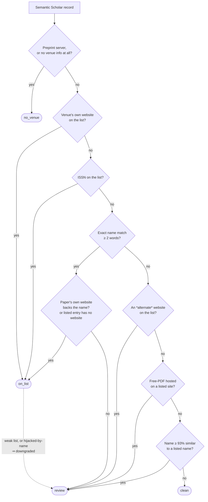

# How the check decides — the matching logic

> Deep-dive companion to [`match.py`](match.py). The main
> [README](../../README.md#6-how-the-check-decides--and-the-six-verdicts) gives the
> short version and links here for the full rules. DOI-based resolution of the
> `review` verdicts is a separate step — see [`resolve.md`](resolve.md).

Everything here is **deterministic**: the same input always yields the same
verdict, and the Excel report shows *why*. The logic lives in
[`match.py`](match.py) and its tunables in [`config.py`](config.py).

## The guiding principle

> Signals are tried **strongest-first, and the first one that matches wins.**
> A *website* or *ISSN* match is treated as solid evidence; a *name* match is
> weaker (names are ambiguous); a *fuzzy* name match is weakest. Nothing
> uncertain is ever asserted — it is downgraded to `review` for a human.

## The decision flow

## The same flow, spelled out precisely

**Step A — Gather the venue signals from the record.**
The check extracts: the *canonical website* (host of `publicationVenue.url`), any
*alternate websites* (`alternate_urls`), every *name* (`venue` +
`publicationVenue.name` + `alternate_names`, normalised), the *ISSN*, and the
*free-PDF host* (`openAccessPdf.url`).

**Step B — Is there anything to check? → `no_venue`.**
- If the venue is a known **preprint server** (arXiv, bioRxiv, medRxiv, SSRN,
  OSF, ResearchSquare, …) the paper has no journal publisher → `no_venue`.
- If there is **no website, no name, and no ISSN** → `no_venue`.

Preprint detection looks only at the *venue*, never at the free-PDF host
(published papers routinely also have an arXiv PDF).

**Step C — Strong signals → `on_list` (high confidence).** Tried in this exact
order; the first hit wins:
1. **Canonical website** equals a listed site, *or* is a sub-page of one
   (e.g. `ojs.bilpublishing.com` sits under the listed `bilpublishing.com`).
2. **ISSN** exactly equals a listed journal's ISSN.
3. **Exact name *with* corroboration** — a venue name (at least **2 words** and
   **5 letters**) exactly equals a listed name, **and** the paper's own website
   backs it up: one of the paper's own venue URLs is the listed site, *or* the
   listed entry records no website at all (so the name is the only identity Beall
   recorded). Capitalisation, accents, and punctuation are ignored, so `MDPI AG`,
   `mdpi`, and `https://www.mdpi.com/` all normalise to the same key. (An ISSN
   match isn't part of this step — it would already have asserted `on_list` at the
   ISSN tier above.)

   An exact name match **without** that corroboration is downgraded to `review`
   (Step D), because distinct journals frequently share a name.

**Step D — Soft signals → `review` (a human should verify).** Only reached if
nothing in Step C matched:
4. An **exact name match whose website is not corroborated** — the venue name
   equals a listed name, but none of the paper's own URLs are the listed site
   (and that listed entry does have a website). Flagged, not asserted.
5. One of the **alternate websites** matches a listed site (the report lists
   *all* such candidates, not just the first).
6. The **free PDF** is hosted on a listed site, even though the venue itself was
   not identified as listed.
7. A venue name is **≥ 93% similar** (but not identical) to a listed name — a
   spelling variant or typo.

Signals 4–6 are then resolved by the paper's DOI when it has one — see
[`resolve.md`](resolve.md).

**Step E — Nothing matched → `clean`.** The venue was identified and is not on
the list.

## The six verdicts

Every paper gets exactly one **status** (the Excel rows are colour-coded by it):

| Status | Colour | Meaning |
|---|---|---|
| `on_list` | 🔴 red | **Strong match:** the venue's own website, exact ISSN, or exact name is on a *core* Beall list. Read as *"appears on Beall's List."* |
| `review` | 🟠 orange | **Weak / uncertain match** a human should double-check (similar name, alternate URL, free-PDF host, hijacked-by-name, or a weak list). |
| `clean` | 🟢 green | The venue was identified and is **not** on the list. |
| `no_venue` | ⚪ grey | A preprint or a record with no venue — nothing to check. |
| `out_of_scope` | 🔵 blue | *Only with a whitelist:* the paper's venue wasn't in it, so it was skipped. |
| `error` | ⚫ dark | The record couldn't be processed (the reason is shown in the row). |

## Three deliberate downgrades from `on_list` to `review`

Even a Step-C "strong" match is downgraded to `review` in three cases
(implemented in `_hit` and `_classify`):

- **Weak lists.** A match against the *vanity-press* list (book/monograph
  publishers such as IGI Global) or the *fake-metrics* list (companies selling
  invented impact factors) is **never** `on_list`. Those are not predatory-
  *journal* signals, so they are surfaced for a human but not asserted.
- **Hijacked journals, matched by name.** A *hijacked* (cloned) journal reuses
  the **real** journal's name to impersonate it, so an exact-*name* match to a
  hijacked entry might actually be the **legitimate** journal. Only a *website*
  or *ISSN* match (the clone's own identity) is asserted as `on_list`; a name
  match is downgraded to `review`. Clearing such a `review` needs positive proof
  — see [`resolve.md`](resolve.md).
- **Exact-name match the website doesn't back up.** A name alone is
  high-confidence only if the paper's own venue is hosted at the *same site* as
  the Beall entry (see Step C.3). Otherwise it's downgraded to `review`.

## Why the canonical website is trusted but alternate URLs are not

Semantic Scholar sometimes **merges two different journals that happen to share a
name** into one venue record. When it does, the `alternate_urls` may point at an
*unrelated* publisher — e.g. a legitimate Elsevier journal whose record also
carries a predatory clone's link. To stay truthful, the check trusts the
**canonical** `publicationVenue.url` (asserts `on_list`) but treats an
**alternate-only** match as `review`, so a human — or the DOI resolver — can
confirm which journal it really belongs to.

## Built-in safeguards against false positives

- **Only real listed hosts are ever match keys**, compared longest-suffix first.
  A paper hosted at `jurnal.unimed.ac.id` can therefore **never** collapse onto a
  public suffix like `ac.id` — that whole class of false positives is impossible
  by construction.
- **Shared platforms are excluded from website matching.** Generic hosts
  (Google Sites, WordPress.com, Blogspot, …) and large *national aggregators*
  that host thousands of legitimate journals (**DergiPark**, **J-STAGE**,
  **SciELO**) are removed from the website index, so one listed journal on such a
  platform can't flag every co-hosted journal. (A genuinely-listed venue on them
  can still match by name.)
- **Fuzzy matching is deliberately strict** (93% similarity), only runs against
  the three *core* lists, and **can only ever yield `review`** — never a
  confident hit.
