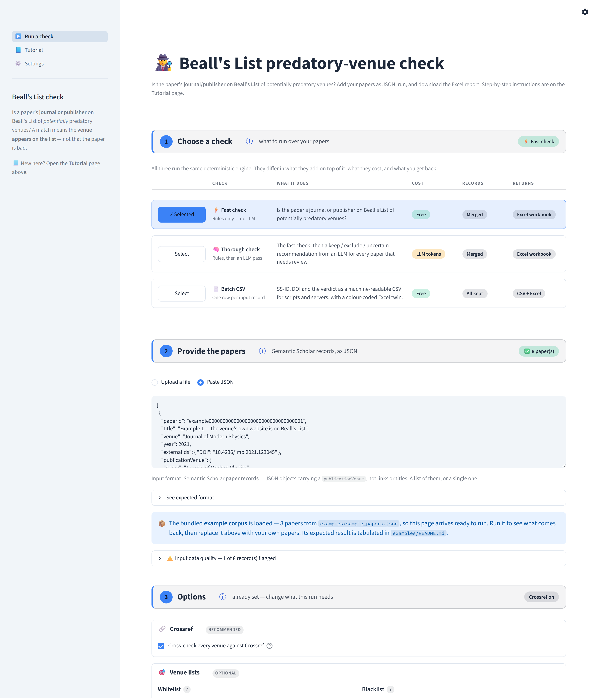
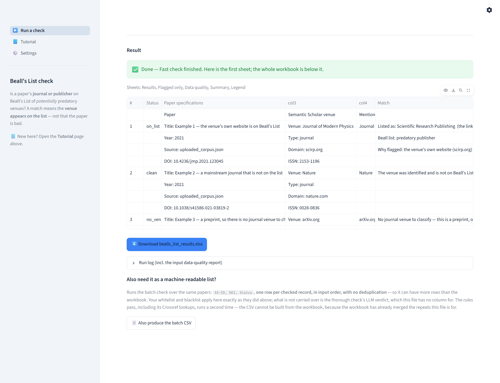
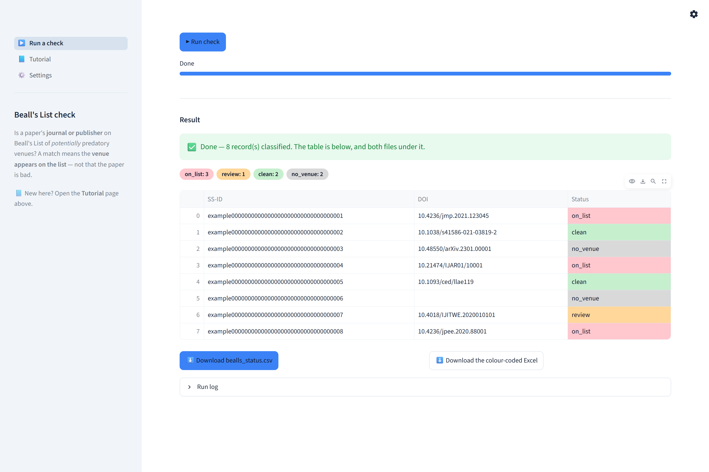

# The web app

> Deep-dive companion to [`app.py`](app.py), [`runners.py`](runners.py) and
> [`doaj.py`](doaj.py). The
> main [README](../README.md) gives the short version and links here.
> For how a verdict is reached, see [`match/`](../src/bealls_list_check/match/README.md)
> and [`resolve/`](../src/bealls_list_check/resolve/README.md).

A [Streamlit](https://streamlit.io) front end for the same scripts the command
line runs. It is intended for **local, single-user** use — it is not a server,
has no authentication, and writes to the same results folder as the CLI.

```powershell
.\run_ui.ps1       # from the repo root; macOS/Linux: ./run_ui.sh
```

The launcher verifies that `.venv` exists (run [`setup.ps1`](../setup.ps1) first
if not), installs Streamlit into it on first use, and starts the app. Neither
launcher pins a port, so use the URL printed in the terminal: `8501` unless it is
taken, in which case Streamlit selects the next free port.



The screenshots here are generated by
[`shoot_screenshots.py`](shoot_screenshots.py), which drives a running app with
Playwright, so they can be regenerated after a UI change rather than left to
drift. The script documents its own invocation.

They live in [`static/`](static) rather than beside it because Streamlit serves
that directory (`server.enableStaticServing`), which is what lets the Tutorial
page render them as plain `` tags. `st.image` re-encodes a PNG as JPEG —
visibly lossy on a picture of text, which every one of these is — and gives no
way through to the full-size original.

## The three checks

Selected in Step 1. All three run the same deterministic engine; they differ in
what they add and what they return.

| Check | Runs | Returns | Records | Cost |
|---|---|---|---|---|
| **Fast check** — rules only, no LLM | [`bealls_list_check.py`](../src/bealls_list_check/bealls_list_check.py) | `bealls_list_results.xlsx` — the full five-sheet workbook | merged | none |
| **Thorough check** — rules, then an LLM pass | [`bealls_llm_check.py`](../src/bealls_list_check/bealls_llm_check.py) | `bealls_llm_results.xlsx` — the same workbook plus an **LLM review** column on *Flagged only* | merged | tokens; requires keys in `.env` |
| **Batch CSV** — one row per input record | [`batch_check.py`](../src/bealls_list_check/batch_check/batch_check.py) | `bealls_status.csv` **and** a colour-coded `bealls_status.xlsx` | all kept | none |

*Merged* means a paper repeated in the corpus is reported once — deduplicated on
`paperId`, falling back to the title. *All kept* means exactly one CSV row per
record supplied, in the order supplied, so a corpus that repeats a paper yields
more rows than the workbook.

The sidebar states, in one sentence, what the tool answers, and lists the two
pages — **Run a check**, documented below, and **Tutorial**, which renders
[`TUTORIAL.md`](TUTORIAL.md) so the walkthrough has one copy, readable both in
the app and on GitHub. It is deliberately short: how the three checks differ is
said by Step 1's comparison table and what shape the input takes by Step 2's
caption, and neither is worth saying twice.

An **Environment** expander naming the configured provider and model used to sit
here as well. It was removed, and the reason generalises: the LLM belongs to one
of the three checks, so a panel present on every page of every run was answering
a question most runs never ask. The two values it held are the starting positions
of Step 3's own pickers, and whether they *work* is now reported twice where it
is acted on — by the readiness line under Step 1 when the check is chosen, and by
Step 4's summary immediately above the Run button.

## Colour

Hues come from the [Tailwind CSS palette](https://tailwindcss.com/docs/colors) —
neutrals from *slate*, the accent from *blue* — declared once as CSS variables in
`_TOKENS` and again as Streamlit's own theme in
[`.streamlit/config.toml`](../.streamlit/config.toml), so the widgets Streamlit
paints and the ones the app paints belong to one palette.

The accent is **not** Streamlit's default red, and that is a correctness point
rather than a preference: red is a *verdict* here. `on_list` is red in the
workbook, in the status chips and in the result preview, so an accent that was
also red made the page read as "flagged" where it only meant "selected".

### Why nothing in `_TOKENS` branches on light versus dark

Because it cannot be made to branch correctly. Streamlit has a theme switcher
(**⚙ → System / Light / Dark**) that repaints the app *without* touching
`prefers-color-scheme`, and it exposes no attribute naming the active theme —
not on `<html>`, `<body>` or `stApp`. An earlier version keyed off the media
query, so anyone whose browser preferred dark and who then chose **Light** got
Streamlit's white page with this file's dark-theme text on it: light grey on
white. There is no signal that would have fixed it.

So the tokens are written not to need one:

| | How |
|---|---|
| Text | `currentColor`, thinned with `color-mix` — a fraction of whatever colour the active theme is already using, so each level keeps its ratio to a background this file never has to know |
| Surfaces, borders | translucent overlays of that same colour: they darken a light page and lighten a dark one, by construction |
| Semantic fills | a translucent wash of one hue with the theme's own text over it — the hue carries the meaning, the theme carries the contrast |
| Accent | a single **opaque** blue-500. Being opaque, the page behind it is irrelevant: the fill clears 3:1 against both white and slate-900, and slate-900 on the fill clears 4.8:1 either way |

One consequence worth knowing when editing: the thinned text colours are
fractions, so **they compound if nested**. 82% inside 82% is 67%. Apply them to
leaves, never to a container that holds another one.

Streamlit's own widgets need no such care — it knows which theme is active, so
the `[theme]` / `[theme.dark]` pair in `config.toml` is applied correctly however
the theme was chosen.

### Code blocks are always dark

Streamlit paints its syntax highlighting in the *same* colours whichever theme is
active, and against its light code background those land at **2.5:1 to 2.9:1** —
numbers, strings and JSON keys were the least readable text in the app, which
matters when the tutorial and the expected-format panel are mostly JSON.

Better colours alone cannot fix it: clearing 4.5:1 against white needs a
luminance at or below 0.183, and clearing it against slate-900 needs 0.228 or
above, so no single value does both — and the active theme is not knowable (see
above). Pinning the code background dark resolves it, after which one set of
light token colours serves both themes at 9:1 to 12:1.

### The exception: status colours

The **status** chips and the shaded Status cells of the CSV preview take the
workbook's canonical fills from `STATUS_FILL_COLORS`, so that the app and the
file it produces cannot disagree. Only the text laid over them is chosen here, by
relative luminance (`readable_on`), which is what keeps `error` — a deep red
among pale fills — legible.

### Verified, not asserted

Every text colour on both pages was swept for WCAG AA in both themes. The only
element below its threshold is the **disabled** Run button's label, which is
exempt (inactive controls) and is still lifted from Streamlit's 2.4:1 to 4.8:1 on
white by a flat slate-500 — flat because the colour it would otherwise take a
fraction of is Streamlit's own already-faded one.

A `_check_css_comments()` assertion runs at import. A stray `*/` in these
stylesheets raises nothing in a browser — it silently discards every rule after
it — and has twice collapsed Step 1's comparison table without a word in any log,
so the app now refuses to start on one instead.

## Pointer and hover

One duration and one curve for the whole app (`--bl-hover`, 120ms — under the
~150ms at which a transition stops reading as a response to the pointer and
starts reading as an animation of its own), so the controls Streamlit paints and
the ones this file paints answer at the same speed.

**The cursor.** Measured across the app, one control disagreed with the rest:
every part of a selectbox — the wrapper, the value, the arrow, the
`role="combobox"` input — computed `cursor: text`, while checkboxes, radios,
expander headers, buttons and the upload dropzone were already `pointer`. A caret
says *type here*; the control opens a menu. It is given the pointer the others
have. The trade is deliberate: Streamlit's selectbox is searchable, and `text` is
the honest cursor for a field that accepts typing. Typing still filters — a
cursor changes no behaviour — but with six providers and a handful of models,
being legible as a menu is worth more than advertising a filter nobody needs at
that length.

**The hover.** Buttons lift 1px onto a soft shadow and drop back on `:active`, so
a press still feels like a press; `:not(:disabled)` keeps the disabled Run button
out of it. Everything else — selectbox, text input, text area, dropzone — is a
field or a row rather than an object, and answers with its border going to
`--bl-accent-line` behind a 3px `--bl-accent-soft` ring instead. A 1px rise on a
full-width text area reads as the layout twitching. The expander header takes the
same wash. `prefers-reduced-motion` drops the movement only: the colour change
carries the same message without it.

> Verifying this in an automated browser is misleading. `getComputedStyle`
> reports a transitioning property's *current* value, and a pane that is not
> compositing frames never advances the transition past t=0 — so a working hover
> reads as no hover at all. Inject `* { transition: none !important }` first and
> the target values appear.

## The Tutorial page

[`TUTORIAL.md`](TUTORIAL.md) is rendered here, so the walkthrough has one copy —
readable in the app and on GitHub. It is not rendered verbatim:

- **Installing and launching are left out.** The file fences them between
  `<!-- app:skip-start -->` and `<!-- app:skip-end -->`, and the app drops that
  block. Anyone reading the page has demonstrably already started the app, so it
  is the one section that cannot apply; it stays in the file for the GitHub
  reader, who has not. Because they are prerequisites rather than steps, they are
  also **unnumbered**, which is what lets the walkthrough still read 1 – 7 with
  them gone.
- **Section headings get the numbered badge** the flow's own steps carry, instead
  of leaving the number as the first character of a line of prose. The `id` is
  the slug Streamlit would have generated (`_slug`), so links into these sections
  — the ⓘs, and the file's own cross-references on GitHub — resolve to the same
  anchors.
- **A contents menu** sits above the first section — one full-width row per
  section, ruled like a table. It was a strip of chips, which is the wrong shape
  for navigation: a contents list is read down a column rather than across a
  wrapped line, the chips re-flowed at every window width, and each entry's
  target was only as big as its text. It lists **every** level-2 section, not
  just the numbered ones; *What this tool checks* and *Where to go next* are as
  jumpable as the seven steps between them, and they carry a dot in the number's
  place so the column still lines up. Sections inside the skipped block are
  excluded, so no row can point at a heading the app does not render.
- **Screenshots are plain `` tags** served from [`static/`](static), not
  `st.image` — which re-encodes a PNG as JPEG, visibly lossy on a picture of
  text. Each is centred, capped at 40rem, and is a link to itself enlarged:
  clicking opens a pure-CSS `:target` overlay. No script is involved, because
  Streamlit strips `<script>` out of markdown. The overlay's `z-index` clears
  Streamlit's own chrome (999990 for the header, 999991 for the sidebar) — below
  those it covered the page but left the header on top of it, and its close
  button unclickable.

  The overlay shows each capture at **1500px, the width it was taken at**, not at
  its 3000px pixel width. `shoot_screenshots.py` captures a 1500px viewport at
  `deviceScaleFactor=2`, so the file is a 1500px picture at 2×; displaying it at
  3000 was showing the app at 200% zoom, which is why opening one landed the
  reader inside a wall of letterforms. It is capped at the window as well, so the
  overlay scrolls down but never sideways — the way the page it is a picture of
  does.

  **Every surface closes it**: the image, the backdrop around it, and a labelled
  button in a fixed bar that also says so. Closing used to be that button alone,
  a 2.5rem `×` to be found on top of a screenshot that had covered the window,
  while the image under the pointer showed `cursor: zoom-out` and did nothing —
  the only click-to-close surface was the backdrop, and the image covered every
  pixel of it. The bar also links to the file itself in a new tab, which is the
  way *up* in scale: at 1:1 the browser's own image viewer has real zoom and a
  Back button, neither of which a `:target` overlay can offer.
- **The column is capped** at 58rem. In `wide` layout a line of prose otherwise
  ran the whole window.

## The toolbar

`client.toolbarMode = "viewer"` in [`config.toml`](../.streamlit/config.toml)
removes the **Deploy** button and the other developer actions. Deploy offers to
publish to Streamlit Community Cloud, which is meaningless for a local tool that
reads this machine's `.env` and writes into the repository.

`"minimal"` would have removed the menu itself, and with it the light/dark
override, so the menu stays — redrawn as a **gear** rather than an overflow `⋮`,
which promised a menu of actions there is no longer one of. The glyph is a CSS
mask over `currentColor`, so it needs no light/dark pair either.

## The page, step by step

Each step carries a header bar: a numbered badge, the title, an **ⓘ**, a one-line
hint, and — on the right — a pill naming that step's live answer. The pill is
green when the step is settled, amber when it is what holds the run up, and grey
when there is nothing to settle. Reading down the four pills therefore states the
whole flow's condition, so a page scrolled halfway still says what would happen
if **▶ Run check** were pressed.

The **ⓘ** opens the Tutorial section that explains that step — the walkthrough is
on another page, and without a way in from here it only reaches the people who
thought to read it first. Each link is resolved at render time by searching
`TUTORIAL.md`'s headings for a phrase (`tutorial_href`), not by a hard-coded
`#4-…`, so renumbering the walkthrough cannot leave one pointing at the wrong
section. They open in a **named tab of their own**: following one in place would
reload the app and discard the loaded papers.

| Step | Pill states |
|---|---|
| 1 · Choose a check | the selected check, always green |
| 2 · Provide the papers | `✅ N paper(s)`, or amber `waiting for papers` |
| 3 · Options | the options in force, e.g. `Crossref on · whitelist (3)` |
| 4 · Run | green `ready`, or amber `add papers first` |

### Step 1 · Choose a check

The three checks are presented as a comparison table rather than a dropdown: they
are meant to be weighed against each other, and a dropdown shows only the option
already chosen. One row per check, and one column per attribute they actually
differ on:

| | Check | What it does | Cost | Records | Returns |
|---|---|---|---|---|---|

The attributes therefore line up vertically, so comparing them is a scan down a
column rather than a reading of three separate blocks. The **Cost**, **Records**
and **Returns** cells are pills whose hover text carries the sentence of detail
that does not fit in a pill — the exact output filenames, what deduplication
matches on, what the LLM pass is charged per.

The leftmost column holds the **Select** button. The selected row is tinted and
its button turns solid — marking it by colour rather than by an accent in the
margin, which would have to reserve space in every row. The button stays enabled,
because a disabled control greys out and grey should not mark the active choice;
re-clicking it does nothing.

A row is **two** Streamlit columns — the Select button, then a single element
holding a five-column CSS grid — rather than six Streamlit columns. Streamlit
hangs `margin-bottom:-16px` on every markdown container to cancel the gap between
elements of a vertical block; a column holding one markdown element has no gap to
cancel, but the negative margin still shortens the column's layout box by 16px
while the text keeps its height and overflows. Streamlit centres that too-short
box, which left the text 8px low beside a Select button that was centred
correctly. The grid centres its own cells and inherits the header row's column
template, so the header and the rows align without either knowing about the
other.

Selecting the thorough check additionally verifies the LLM configuration, using
the same `validate_provider_config()` the check itself calls. A missing key or
endpoint is reported here, naming the empty `.env` values, rather than after a
run has already been paid for. Both the provider and the model named are the ones
**Step 3 has selected**, so this line and the run it describes cannot disagree —
which is why `validate_provider_config()` takes a provider argument at all: Step
3 can point a run at a backend other than the one `.env` names, and a readiness
line answering for `.env` would then be answering about a different run.

That verdict has a **line reserved for it under the table whichever check is
selected**, and the line is a fixed height. It used to be rendered only for the
thorough check, so choosing that check inserted an element and pushed Steps 2 to
4 down the page; reserving the line costs 24px and removes the jump entirely. A
message too long for one line is clipped, and carries the whole text as hover
text.

The selection does not disturb anything else on the page: loaded papers and
options survive a change of check.

### Step 2 · Provide the papers

Semantic Scholar **paper records**, from one of two sources — a `.json` upload or
a paste box. Accepted input:

- a **JSON list** of paper objects, or
- a **single** paper object (it is wrapped into a list automatically).

Anything else is rejected with a message rather than a traceback. **`.jsonl` is
not accepted** — convert it to an array first, or use `batch_check.py` on the
command line, which reads `.jsonl`, `.ndjson` and `.json`. Streamlit's upload
limit is 200 MB per file. An expander shows the expected shape.

The upload target is a full-width dashed dropzone that says a file can be dropped
on it. Streamlit's own is a 68px strip with a Browse button, which does not; it
is restyled rather than replaced, so it is still the same widget.

The bundled [example corpus](../examples/README.md) is **not** a third source.
Offering it as one made the input picker mix two different questions — *where is
your data* and *I have none, show me* — so it is a button below the input,
**📦 Load the example corpus**, which fills the paste box with the records. That
needs no state of its own, leaves the page in a shape the user could have reached
by hand, and puts the corpus on screen where it doubles as a worked example of
the input format.

#### The input data-quality panel

As soon as papers load, an **Input data quality** panel reports how many of them
have suspect Semantic Scholar metadata — computed offline, in-process, *before*
any check runs, so problems surface before tokens or minutes are spent. The first
five are listed inline; the **Download report (.xlsx)** button produces
`input_data_quality.xlsx` with **one row per record supplied**, reading `OK` where
there is nothing to report.

It stays **collapsed**, whatever it found. It reports on the metadata that was
*supplied*, not on anything the tool has done, and some flags are normal for a
real corpus — the bundled example is deliberately one of those, because record 6
carries no venue at all. Opening itself and leading with a warning meant a green
*"Loaded 8 paper(s) — ready to run"* was immediately contradicted by what looked
like an error. The count is in the label, which is the part worth seeing.

This panel runs for all three checks — including Batch CSV, whose command-line
form skips input validation entirely.

### Step 3 · Options

Every control here already has a value, so a run can be started without touching
any of them. The header says so — *already set — change what this run needs* —
rather than the *all optional* it used to say. Both are true, but every other
step's hint names what the step is **about**, while that one described its
obligation level, in a word that reads as *ignorable*. One of these settings
decides what the run spends money on.

- **LLM provider** and **Model / deployment** — shown for the **thorough** check
  only, since it is the only one that uses an LLM. Offered as a pair because
  either alone is half an answer: a model name means nothing without the backend
  that serves it, and a provider without a model just moves the question. The
  provider list is `openai_client.SUPPORTED_PROVIDERS`, plus `.env`'s own value
  when that is something else — an unrecognised `LLM_PROVIDER` is passed through
  to litellm untouched, so a dropdown that dropped it would silently switch the
  run to another backend.

  The model list is whatever `openai_client.provider_models()` reports for the
  selected provider: `AZURE_OPENAI_DEPLOYMENT` for the provider `.env` itself
  selects, `LLM_MODELS_<PROVIDER>` for any other, each accepting a bare name, a
  comma-separated list or a JSON array. It ends with **Other**, which reveals a
  text box. A typed name cannot be checked before the run and the caption says
  so, but "cannot be verified" is not "must not be offered": a list alone was a
  dead end on any machine whose `.env` happened not to name the wanted model, and
  the advice it could give — edit `.env`, restart — is exactly the ceremony this
  control exists to remove.

  Changing the provider reassigns the model to the new provider's first name (or
  to *Other*) rather than clearing it. Clearing left the picker offering the new
  list while still displaying the old provider's name: Streamlit rebuilds the
  options, but a widget whose stored value has vanished is not redrawn with its
  new default.

  Both selections reach the check the way the check already looks for them:
  `runners.run_checker` is given `env_overrides={"LLM_PROVIDER": …,
  "AZURE_OPENAI_DEPLOYMENT": …}`, and `openai_client` reads both from the
  subprocess environment at import. python-dotenv does not overwrite a variable
  that is already set, so the choices win over `.env` without touching it and
  without outliving the run. Both are recorded on the workbook's Summary sheet.
  Switching either previously meant editing `.env` and restarting the app.
- **Crossref** — a single checkbox, in the open, on by default. Clearing it is
  exactly `--crossref off`. It is skipped automatically when there is no
  internet. It changes verdicts: two of the example corpus's eight records fall
  back from `on_list` to `review` without it.
- **Venue lists** — the whitelist and the blacklist, side by side, in the open.
  They were folded away for being rare, but rare is not the same as advanced, and
  a fold answers the wrong question: it hides *what the run is doing* behind a
  click, so the only way to confirm that no venue list is in force was to open a
  panel and read two empty boxes. Shown, they answer that by being visibly empty.
  Side by side rather than stacked is what the fold was really buying — two 90px
  boxes in a column pushed the Run button off the screen — and the two are a
  pair, one narrowing the run and the other widening it, so a row reads them as
  the opposites they are.

No *setting* in Step 3 is folded away. A step whose header claims to summarise
the settings in force cannot do that while some of them are behind a click. The
whitelist's DOAJ search sits in a fold and is not an exception to that rule: what
is behind the click is a **finder**, not a setting. Whatever it finds lands in
the list above it, in the open, where it can be read and removed.

### The venue lists are edited as lists

Each list is a column of rows with a ✕ on each, built by typing or by searching
DOAJ, with the JSON it serialises to kept underneath in an **Edit as JSON** fold.
The controls come first and the rows follow: the list is the only part that
grows, so entries appear inside a box whose position is fixed rather than pushing
the controls that created them down the page.

#### One control, and a layout that does not move

Each list is built with a **single search-as-you-type box** and an Add button.
It was three controls — a text box, a DOAJ search box and a results dropdown —
which was one question, *which venue*, asked three times, and left the answer
half-entered in one of them while another held something else.

Both columns render the **same skeleton in the same order** and every band has a
height that does not depend on its contents. Measured in the running app —
adding four venues, removing one, and running searches that match and that do
not — every band keeps the same offset and the same height, in both columns:

| Band | height | offset below the heading |
|---|---|---|
| heading (`.bl-vl-head`) | 86px (`min-height:5.4rem`) | 0 |
| search box + Add | 38px | 86px |
| note (`.bl-vl-note`) | 40px (fixed, clipped) | 142px |
| list box (`st-key-venuelist-*`) | 190px (`st.container(height=…)`) | 182px |
| JSON fold | 40px | 388px |

Four things buy that:

- **The list box is a fixed-height scrollable container.** `st.container(height=)`
  rather than a stylesheet rule, so the scrolling is the container's own.
- **The rows sit below the controls**, so the one part that grows cannot push the
  controls that created them down the page.
- **The heading and the note are fixed bands.** The note is the search's only
  feedback, and it is clipped at two lines so the longest thing DOAJ can return —
  a network error — occupies exactly what the shortest does. The full text is on
  the control's tooltip.
- **Nothing is conditionally rendered.** Both comboboxes, both notes and both
  **Clear the list** buttons are always present, Clear merely disabled when there
  is nothing to clear, because a control that comes and goes takes its band's
  height with it.

### Two directories, one for each list

Each box searches as the name is typed, but not the same catalogue — and the
reason is the one that makes the two lists opposites:

| List | Directory | Why that one |
|---|---|---|
| **whitelist** | [DOAJ](https://doaj.org) | Lists journals that *passed* an editorial screening — the venues someone narrowing a run is naming. |
| **blacklist** | [Crossref](https://www.crossref.org) | The DOI registry: a journal is in it because its publisher pays to register DOIs, which screens for nothing. A venue worth blacklisting is by definition **not** in a directory of vetted ones, so DOAJ cannot help name it — while registering DOIs is part of *looking* established, so the venues a blacklist is for are here. |

Both hand back the same [`Venue`](venue_lookup.py), so the box that offers it and
the entry it becomes never have to know which directory it came from. Choosing a
match adds it with its official title and ISSN — choosing *is* adding, so there
is no button beside each result. **Add** takes the text verbatim instead,
whether or not the directory knows it.

#### DOAJ: the whole list, downloaded once

DOAJ's search API cannot be called per keystroke. Measured: typing four letters
into it earns a Cloudflare **502 with `Retry-After: 60`**, and the box then
reports a timeout instead of matches. It is also not ours to do — DOAJ is a free
service run by a non-profit.

DOAJ publishes the entire journal list as one CSV for exactly this reason, so
[`doaj.py`](doaj.py) fetches it **once** (~23,000 journals, ~25 MB), reduces it
to the fields a venue entry needs, and caches it in `ui/.cache/` (gitignored,
refetched after a fortnight). Everything after that is local:

| | |
|---|---|
| First load | ~25 s, once per machine per fortnight |
| Cached load | ~0.1 s |
| One search | 30-90 ms over 23,000 journals |

So the box keeps up with typing, works offline once primed, and puts no load on
DOAJ at all. The trade is that a journal added to DOAJ since the last fetch has
to be typed by hand — which the box allows anyway.

Ranking is by how early and how cleanly the term appears: a title that *starts*
with it, then a *word* of the title starting with it, then anywhere in the title,
then the publisher. Shorter titles win ties, so "nature" offers *Nature* before
*Nature Reviews Methods Primers*. An ISSN is matched exactly instead.

#### Crossref: a live API, so a floor and a longer debounce

Crossref publishes no bulk journal file small enough to be worth downloading
here, so [`crossref.py`](crossref.py) queries `/journals` live. It meters by
**rate** rather than by budget, and every response says so:

```
X-Rate-Limit-Limit: 5   X-Rate-Limit-Interval: 1s   X-Concurrency-Limit: 1
```

Five requests a second anonymously — doubled to ten, and three concurrent, for a
caller that identifies itself. That is far more headroom than OpenAlex's ~100
searches per 7 hours (what this box used to query), but a search still costs a
~0.55 s round trip and ~3 KB per journal returned, so this side:

- **does not search below two characters.** A single letter is a real query —
  `w` answers with 342 journals — but not an answer anyone can use, and it costs
  a round trip. The note says so rather than pretending nothing matched.
- **debounces at 300 ms** rather than DOAJ's 120, because a keystroke here goes
  over the network. Normal typing comes to one or two requests per word.
- **caches every term for an hour**, so extending and backspacing a word replays
  from cache.
- **treats a 404 on the ISSN path as an answer**, not a fault: no journal is
  registered under that ISSN.

Set `CROSSREF_MAILTO` in `.env` to join Crossref's polite pool; harmless if
unset. It is the **same variable** the run's own DOI cross-check reads
(`src/bealls_list_check/data_quality.py`) — one address, two unrelated uses of
one service, and no new dependency for this box.

**A Crossref journal record carries no website.** Its fields are the title, the
ISSNs, the publisher and usage statistics; there is no homepage. So a venue added
from the blacklist's directory is a name and its ISSNs, never a domain — which is
the safe direction anyway, and why the ⚠ shared-platform marker below is a DOAJ
matter. A publisher domain is still added deliberately, by typing it in.

#### The control

`st.selectbox` cannot do any of this: it filters options **client-side** over a
list it was given, so it can never look anything up while a word is being typed.
The box is therefore [`streamlit-searchbox`](https://pypi.org/project/streamlit-searchbox/),
which calls back into Python per keystroke.

Eight things about it are deliberate, and each was wrong before it was fixed:

| | Why |
|---|---|
| No chevron (`dropdown: {width: 0, height: 0}`) | A chevron promises a list to open. On an empty box there is none — this is a box you type into, not a menu that tolerates typing. |
| No "No options" message (`optionEmpty: "hidden"`) | It was being drawn under an untouched box, announcing the absence of results for a search nobody had run. |
| **Add** inside the box, at the right-hand end | It acts on the text in the box and nothing else, so it is the box's own button rather than a second control taking a quarter of the width from the thing being typed into. It has to be *overlaid* — the input is inside the component's iframe and no Streamlit widget can be rendered in there — so the container is the positioning context and the button is lifted out of flow onto the right edge, clearing the iframe's `z-index`. Out of flow it has no width to inherit, and Streamlit's label will shrink to one character per line (measured: 8 px wide, 67 px tall, inside a 28 px button), so every level from the button down is pinned to `nowrap` and `max-content`. |
| Add only once something is typed | On an empty box it offers to do something that cannot work. |
| Add becomes a **spinner** while a search is out | Typing into the blacklist costs a round trip to Crossref (~0.55 s, behind a 300 ms debounce), and for all of it the page still showed the frame from before the keystroke with Add looking as ready as ever. See below. |
| `style_absolute=True` | The menu lives *inside* the iframe, so the frame grows to ~350 px to show it. In normal flow that pushed the list and the JSON fold a third of a screen down on every keystroke and left the two columns at different heights; positioned absolutely it overlays instead. |
| A **box that looks like a box** (`searchbox_styles`) | The component leaves an unfocused control with `1px transparent`, which on this page is a field with no edge at all — placeholder text floating where a control should be. It is given the fill and border Streamlit gives its own inputs. Its `&:hover` has to be replaced too, or hovering puts the transparent border back. |
| The open menu is a **raised plane**, not a bordered region (`searchbox_styles`) | See below — this is the one that took three attempts. |
| An empty box **opens nothing** (`wrapper: {overflow: hidden}`) | See below. |

##### An empty box must not open an empty menu

The component decides for itself whether the menu is open:

```js
menuIsOpen: this.props.args.options && this.state.menu
```

`state.menu` is true from the moment the box has focus, so the whole guard is
`args.options` — an **empty JavaScript array, which is truthy**. Clicking an
untouched box therefore opened a menu holding nothing. Invisible for as long as
the menu was drawn in the page's own colour; a raised plane turned it into a
small empty panel appearing under an empty field.

Nothing can be done from the options side. Making them falsy does close the menu,
but `openMenu` maps over them *outside* that guard, so a falsy value throws —
measured, `Cannot read properties of null (reading 'map')` on the first click. No
JavaScript value is both falsy and mappable.

So the menu is left to open and is **clipped away instead**: `overflow: hidden`
on the component's own wrapper, which is an ancestor of the box the menu is
positioned against, and only for as long as there is nothing to show. A clipped
menu also adds no scrollable overflow, so the frame stays exactly the height of
the field (measured: 38 px with nothing to list, 366 px with eight matches).

That clip is why the focus ring is drawn `inset`. An outset ring would be clipped
along with the menu, and the field would lose its focus state exactly when it is
empty — which is when it is most likely to be focused.

##### Why the dropdown read as transparent

The component fills its menu with Streamlit's *page* background, so the open
dropdown was drawn in the exact colour of the page it was covering. It sizes
itself to its contents, so a two-line match covers the note and the top of the
venue list and stops — and the list box's border resumes immediately underneath,
its rows carrying on in the same colour, at the same width, in the same kind of
row. The two panels merge into one and the list's entries read as more matches.

A 1 px ring did not fix it, because the venue list box has a 1 px border too.
What separates an overlay from what it covers is **elevation**, and elevation is
not the same thing in the two themes:

- **Dark** — a shadow has almost nothing to darken against slate-900, so the lift
  is a *lighter surface*: menu and field on slate-800, one step above the page.
- **Light** — white on white needs the opposite: the surface stays white and the
  depth comes from a shadow, which does show on a light page.

Five mechanics decide how that is written, and none is a preference:

- **The ring is an `inset` box-shadow, not a `border`.** A border would change the
  list's box, and the list has to stay exactly the size of the container
  react-select draws behind it.
- **`borderRadius` is 4 px, matching react-select's own menu**, not the app's 8.
  The component forwards only the style keys it documents and `menu` is not one
  of them, so that container keeps react-select's white `neutral0`; the list sits
  in the same box and hides it. Round the list *more* than 4 px and the white
  reappears at all four corners — measured.
- **The list carries a bottom margin (`_MENU_GAP`), or there is no shadow at
  all.** Streamlit sizes the iframe to `document.body.scrollHeight`, which ended
  at the menu's bottom edge — so a drop shadow, which paints *outside* that edge,
  was clipped away entirely and the panel met the list box with nothing in
  between. The margin is counted rather than collapsed away, because a scrolling
  list is its own formatting context (measured: `scrollHeight` 118 → 142).
- **That margin grows the white container, so it is masked.** The extra band
  belongs to `menu`, which is white. It is covered by a third box-shadow: a copy
  of the list's own shape, in the page's colour, offset down by exactly
  `_MENU_GAP` so it lands on the band and nowhere else. A `spread` would have
  been simpler and was wrong — it reaches *upwards* too, and 26 px of it painted
  over the bottom of the field.
- **The menu's height is fixed (`_MENU_HEIGHT`), not sized to the match count.**
  This is the one that finally settled it. An opaque overlay sized to its
  contents ends wherever the number of matches puts it — and when that is
  *inside* a row of the list underneath, the part of the row below the edge stays
  on screen. Measured: a two-line DOAJ match ended the overlay at y=479 while the
  first row's ✕ ran from 462 to 493, leaving the bottom 14 px of a button sitting
  under the panel, looking like part of it. An edge that always lands in the same
  place cannot land inside a row, so the menu is given the exact height that puts
  it on the list box's bottom edge (measured: 294 px below the top of the search
  box, hit exactly). Content taller than that scrolls, which it did anyway past
  eight matches. The cost is a part-empty panel for one or two matches; the
  alternative is a sliced row, and a stable edge is worth more.

The height is summed from the bands between the two:

| | |
|---|---|
| 48 px | the two empty blocks `style_absolute` leaves to reserve the frame's space |
| 16 px | Streamlit's gap between elements |
| 40 px | the note band (`.bl-vl-note`) |
| `_VENUE_BOX_HEIGHT` | the list box itself |
| less `_MENU_OFFSET` | the 38 px field and the menu's own 8 px top margin |
| less `_MENU_GAP` | the gap below the panel |

**In pixels, and it has to be.** The height is applied *inside* the component's
iframe, whose document has its own root font size — Bootstrap's 16 px, which the
page's does not change. So `rem` there does not mean what `rem` means in the
bands it is matched against: written as `calc(6.5rem + …)` it stayed at 294 px
while a page at a 20 px root font grew its bands to 320 px, and the overlay fell
26 px short.

> **Known limit.** Two of the three bands are set in `rem` by Streamlit itself
> (the reserved band, and the gap between elements) and are not ours to pin —
> rules that set them are matched but lose to Streamlit's own, measured. So a
> reader whose browser default font size is not 16 px gets an overlay a little
> short of the list box (16 px at a 20 px root) or a little past it (12 px at
> 13 px). Short is the one that shows. At the default, which is what almost every
> reader has, it lands exactly.

##### The overlay has to win the stacking contest

`style_absolute` gives the iframe `z-index: 10`, and for a long time that looked
sufficient — Chromium hit-tests the iframe on top and nothing appears wrong. It
is not sufficient, because **a `z-index` only competes inside its own stacking
context**, and Streamlit wraps every element in a layout wrapper of its own.
Where that traps it, the note and the venue list's own text paint straight over
an open dropdown — reported and photographed, with
`8 of 31 DOAJ match(es) — choose one…` printed across the first match.

So the box **and** the wrapper Streamlit puts it in are both lifted to
`z-index: 30`. They are siblings of the note and the list within one block, so
lifting this subtree puts it above them whatever any wrapper does. Verified by
giving every layout wrapper and element container a competing `z-index` — the
overlay still wins with the lift, and reproduces the reported artifact exactly
without it.

The `:has()` rule degrades safely: a browser without it drops that selector and
keeps the container's own lift.

Naming an option's `backgroundColor` **flattens its hover**: the overrides are
spread over a value the component computes from the row's state, so the row under
the cursor stops changing colour. A raised menu has to name one, so the hover is
given back as a nested `:hover` — the styles reach react-select through emotion,
which honours it (verified in the generated rule:
`.css-…-option:hover { background-color: rgb(51,65,85) }`).

Two further details of the Add button are structural rather than cosmetic. Its
container is given the field's own height (`--bl-venuefield: 38px`) and centres
what is in it, instead of being offset by a hand-computed `top`: a pixel offset
is correct only while the button is exactly 28 px and the field exactly 38, and
goes visibly off-centre the moment a font size, a zoom level or a Streamlit
version changes either. And exactly **one** box in the chain is positioned —
absolutely positioning both the element container and `stButton` stacked their
offsets, putting the button 5 px below centre.

##### The spinner is CSS, and it has to be

The wait happens **inside one blocking call**: the component hands the term to
Python, Python queries, sets the options and reruns — and Streamlit paints only
when a run *finishes*, so there is no frame in between for Python to draw a
spinner into. A run that ends in a rerun has its output discarded anyway, which
is the same reason the "Added X" toast has to be queued (`notify_next_run`).

So it keys off Streamlit's own `data-test-script-state="running"` on `stApp` —
the only signal available. It cannot be narrowed to *which* box is busy: neither
`:focus-within` nor `iframe:focus` crosses into the component's frame (measured,
both false while the input inside it holds the caret). The scope that remains is
tighter than it sounds, because **Add only exists while a box holds a term nobody
has committed yet** — the same situation as "I am searching". A rerun with both
boxes empty has no button to spin.

The label is hidden rather than removed so the button keeps its 47 × 28 px box and
nothing moves; `pointer-events: none` matches the fact that it cannot be pressed
mid-run. Under `prefers-reduced-motion` the ring stops turning and the "not now"
is carried by the missing label alone.

#### Show more, rather than a silent top-eight

The menu opens with eight matches and its last row says how many it is holding
back — `▾ Show 20 more (130 further match(es))`. Choosing it widens the window by
twenty and re-runs the search; the term stays, and nothing is added.

That row exists because both searches report a **total**, not just the slice. A
menu showing eight of a hundred and thirty-eight, silently, claims to be the
answer when it is a sample. DOAJ's scan is uncapped so its total is exact;
Crossref reports `message.total-results`.

Two component defaults have to be turned off for it: `clear_on_submit` and
`edit_after_submit`. Show more *is* a selection, so both would fire — emptying
the box and closing the menu, throwing away the very term whose next page was
just requested. The clearing is done in the handler instead, which knows the
difference between turning a page and choosing a venue.

`search_function` only fires on a keystroke, so after a Show more the component
would still be holding its previous options. `_refresh_options` writes the longer
list straight into the component's `options_js` / `options_py` state, which it
re-reads on every render.

#### Why choosing a match has to rerun

`submit_function` is called **while the page is being drawn** — the box above it
has already been rendered by the time the handler runs. Everything the handler
writes therefore lands one render too late, and that one fact caused three
separate complaints:

| Symptom | Cause |
|---|---|
| "it doesn't add, then next time it does" | `_reset_box` writes no `options_py`, and the component falls back to handing on the **raw option index** when that key is missing. An integer has no `to_entry`, so the click after an add was dropped. |
| "randomly empties the input" | `_reset_box` changes the key that remounts the React side, which is the only thing that empties the box. With no rerun the box kept the term and emptied later, in the middle of whatever was typed next. |
| "the input shifts down and up" | a **loading skeleton**, see below. |

So the handler reruns as soon as it has acted. The component does exactly this
for its own `clear_on_submit`, from the same place. Confirmations are queued with
`notify_next_run` and emitted by `flush_notices` at the top of the next render,
because a toast raised in the run being abandoned goes with it.

#### Why the band is pinned, and the skeleton hidden

Choosing a match remounts the component — that is how the box clears — and while
the new iframe boots, Streamlit shows a **loading skeleton** in its element
container. The iframe is absolutely positioned and contributes no height, but the
skeleton is in flow. Sampled every frame across a pick: the band went 48 px →
92 px for ~280 ms → 48 px, carrying the note, the list box and the JSON fold 44 px
down the page and back. That is the input "going down and up".

Two rules fix it, and the first failed on its own in a way worth recording:

- **`min-height: 0`, not just `height`.** The container is a flex item, so its
  `min-height: auto` resolves to the automatic *minimum content size*, which
  outranks any height given to it. Measured: `height: 48px !important` computed to
  48 px while the box still stood 92 px tall. Zeroing the minimum is what lets the
  pin hold; the skeleton then overflows the band silently.
- **The skeleton is hidden inside this box.** Contained, it moves nothing — but it
  would still flash a 44 px grey placeholder across the note, and it tells nobody
  anything: the space is already reserved and the thing loading was on screen a
  moment ago.

A container whose whole job is to reserve a fixed band must not be sized by what
happens to be inside it (`_VENUE_BAND`).

The rerun exposed one more thing, latent until then. Streamlit **replays a
component's last value on every render**, so after a page turn the component
re-sends the option index the user clicked — and `_refresh_options` has just made
that index mean something else, the row that said *Show 20 more* now being the
ninth of twenty-nine venues. Measured: turning one page of a `journal of` search
put *Journal of Fungi* on the list unasked. A remount (`_remount_box`) is the
only lever, because only a new widget id retires the stored value; the term
survives it by being handed back as `default_searchterm`.

> A remounted react-select has no focus, so **after Show more the menu comes back
> closed** — the note reads `28 of 4521` and the longer list is one click on the
> box away. The alternative was to leave it open and suppress the replay by
> pretending the venue at that index had already been chosen, which makes that one
> venue silently unpickable until the user picks something else. An extra click
> beats a control that ignores you.

**Adding a venue contributes its title and ISSN, not its website.** A domain is
matched by host, so adding the site of a journal published on a platform
(`sciencedirect.com`, `nature.com`, a shared OJS install) would put every other
journal on that platform in scope; DOAJ matches whose host looks like a platform
are marked with a warning sign. A publisher domain is added deliberately, by
typing it into the same box.

Neither directory takes any part in a verdict. Being listed in DOAJ means a
journal passed its screening; being in Crossref means only that someone paid to
register its DOIs. The question this tool asks is whether the venue is on Beall's
List, which neither answers. The search only helps *name* a venue.

That distinction is why the whitelist's caption spells out that `out_of_scope`
means **not examined** rather than cleared. DOAJ is the canonical index of
*legitimate* journals, so putting a DOAJ search next to a box called "whitelist"
invites reading the box as *venues I trust, so don't flag them* — which is the
opposite of what it does.

The two lists are labelled by what they do, with the familiar term kept as a
secondary identifier. "Whitelist" alone is ambiguous in this domain — it reads
just as easily as *venues I consider safe*, which is the opposite of what it
does:

| Box | Effect | CLI |
|---|---|---|
| **Only check these venues** *(whitelist)* | Restricts the run. A paper from any venue not listed is reported as `out_of_scope` — **not examined**, which is not the same as cleared. | `--whitelist` |
| **Also treat these venues as predatory** *(blacklist)* | Extends the list, for this run only. | `--blacklist` |

Both fold open to the same JSON the CLI flags take as a *file*, editable in
place:

```json
[{"name": "IEEE", "domain": "ieee.org"}, {"issns": ["2666-2485"]}, "Nature"]
```

The format is documented in
[`user_lists/README.md`](../src/bealls_list_check/user_lists/README.md).

**Batch CSV shows no venue lists at all.** It takes neither — there is
no `--whitelist` or `--blacklist` on
[`batch_check.py`](../src/bealls_list_check/batch_check/batch_check.py) to hand
them to; it classifies every record it is given. The section used to be
rendered anyway, holding a note saying so, which made a control labelled
*"narrow the run, or add venues of your own"* promise two things and then
apologise for having neither. The fact is not lost: Step 4's summary reports
`Whitelist: not used here` with the reason as hover text, which states it as a
property of the run rather than as a dead end, and costs no click to find.

The step's pill names the options actually in force, each list with the number of
venues on it (`whitelist (3)`) rather than merely the fact that it is not empty.
It is read from `st.session_state` rather than from the widgets: the header is
drawn above the controls it summarises, and Streamlit has already written the
current rerun's values there. It counts the *list*, not the JSON box's text, so
the pill and the rows drawn below it cannot disagree.

### Step 4 · Run

A labelled cell per decision made above — **Check**, **Papers**, **Crossref**,
**Whitelist**, **Blacklist**, **You get back**, and **Model** on the thorough
check — so what is about to run can be checked without scrolling back up. It was
a row of bare pills, which failed on the values that do not name their own field:
`Fast check` and `Crossref on` say what they are, but `8 paper(s)` and a lone
list name do not, and nothing said what would come back at all.

The whitelist and blacklist cells read `not used here` under Batch CSV rather
than being dropped, so their absence is stated rather than left to be noticed —
and, since Step 3 no longer offers that check an expander it cannot fill, this is
the only place the flow mentions them. Hovering either gives the reason.

The **Run check** button stays disabled until papers are loaded. During the run a
progress bar and the latest log line are shown. The bar is a true percentage only
for the thorough check, which prints a `[i/N]` counter per venue; the fast and
batch checks have no per-item counter, so the bar pulses to show the run is
alive. A toast announces the outcome.

## What you get back

A result survives a change of selection in Step 1 and stays labelled with the
check that produced it, together with a note that a fresh run is needed for the
newly selected one. Nothing is silently relabelled.

### Fast and thorough checks

A success banner, a **download button** for the workbook, and a preview of its
**first sheet, first 40 rows**, with the sheet names listed above it. Below that,
a **Run log** expander holds the check's console output — including the
data-quality report — truncated to the last 8,000 characters, and it opens
automatically when a run fails.



#### Adding the CSV afterwards

A workbook result is followed by **Also produce the batch CSV**, which runs the
batch check over the same papers and appends the CSV, its colour-coded Excel twin
and the status chips beneath the workbook.

It is an action rather than an automatic by-product because the CSV **cannot be
derived from the workbook**. The two disagree on record handling by design: the
workbook is deduplicated on `paperId` → `title`, whereas the CSV carries one row
per input record, in input order. Producing it therefore means running the
deterministic pass a second time, repeating every Crossref lookup — a cost worth
paying on request and not worth imposing on every run. For the same reason the
CSV ignores any whitelist or blacklist, and never carries the thorough check's
LLM verdict; the button's caption states all of this before it is pressed.

The result is discarded whenever the check selection changes or a new run starts,
so a CSV is never shown next to a workbook it did not come from.

### Batch CSV

Per-status **count chips** in the canonical status colours, then two downloads and
a 100-row preview whose Status cells are shaded to match.

- **`bealls_status.csv`** — the machine-readable `SS-ID, DOI, Status` file, one
  row per input record in input order.
- **`bealls_status.xlsx`** — the same three columns with the status colour
  applied. A CSV cannot carry colour; this is its human-readable twin.



The colours come from `STATUS_FILL_COLORS` in
[`config.py`](../src/bealls_list_check/config.py), so the chips, the preview, the
Excel twin and the main report cannot drift apart.

## Differences from the command line

The most useful table here — the app is not a strict superset of the CLI.

| | Web app | Command line |
|---|---|---|
| `--limit` (cap LLM cost) | **not available** — the thorough check assesses every distinct `review` venue | `bealls_llm_check.py --limit N` |
| LLM provider | picked per run in Step 3 | whatever `LLM_PROVIDER` names |
| Model / deployment | picked per run in Step 3, from the names `.env` configures for that provider — or typed in | whichever `AZURE_OPENAI_DEPLOYMENT` names first |
| Crossref | checkbox: on / off | `--crossref all \| flagged \| off` |
| Whitelist / blacklist | pasted JSON; Fast and Thorough only | file path; also on `bealls_llm_check.py` |
| `.jsonl` input | not accepted | `batch_check.py` only |
| Input data-quality validation | always, for all three checks | main check yes, `batch_check.py` no |
| Record handling | Fast/Thorough deduplicate on `paperId` → `title`; Batch CSV keeps every record | same |
| Example corpus | **Load the example corpus** in Step 2 (fills the paste box) | `BEALLS_CORPUS_DIR=examples`, or pass the file |
| Workbook **and** CSV | one run, then **Also produce the batch CSV** | two commands |

## Limits and gotchas

- **No cancel and no timeout.** A run stops only when it finishes or the launcher
  is stopped; closing the browser tab does not end it.
- **Results are written to one shared folder under a fixed filename**, and the app
  reads back the newest `.xlsx` created since the run started. Two overlapping
  runs — two browser tabs, or the CLI at the same time — can therefore hand one
  session the other's workbook. Run one at a time.
- **`.env` is read once, at startup**, and the LLM-readiness verdict is cached
  per provider for the session. Restart the app after editing it — including
  after **adding a deployment to a list**, which is what Step 3's picker offers.
  Which provider and which model a run uses needs no restart; adding to a list
  does, and *Other* is the way round that without one. The names come from
  `AZURE_OPENAI_DEPLOYMENT` for the provider `.env` selects — a historical name,
  whichever provider that is — and from `LLM_MODELS_<PROVIDER>` for the rest.
- **The readiness check is a configuration check, not a live call.** It confirms
  that the selected provider's key and endpoint are present, not that they are
  valid, and it says nothing about whether the selected model exists — least of
  all one typed into *Other*, which nothing but the provider can confirm.
- **The coloured status preview needs pandas**, which arrives as a Streamlit
  dependency rather than a direct requirement; without it the table still renders,
  just without colour.
- **The preview is a preview.** 40 rows of the first sheet (100 for the CSV) —
  download the file for everything else.

## How a run actually works

The checks are **not imported in-process**. They use flat module names
(`config`, `match`, …) that would collide with each other, so
[`runners.py`](runners.py) runs each as a subprocess instead:

1. The uploaded records are written to a temporary corpus directory.
2. `BEALLS_CORPUS_DIR` is set to point at it — **overriding** whatever the
   environment already had.
3. The script is launched with `python -u <script>`, stdout streamed line by line
   so the progress bar can move; the whitelist and blacklist are written to temp
   JSON files and passed as the usual CLI flags.
4. The resulting workbook is read back from `src/bealls_list_check/results/`,
   preferring any `.xlsx` newer than the run's start time — which is what makes
   the locked-file fallback (`…_YYYYMMDD_HHMMSS.xlsx`) work here too.

One visible consequence: the workbook's **"Corpus files"** metadata always reads
`uploaded_corpus.json`, regardless of what the uploaded file was named.

Batch CSV mode follows the same pattern but passes a single input file and `-o`,
and reads back the CSV before the temporary directory is removed.
