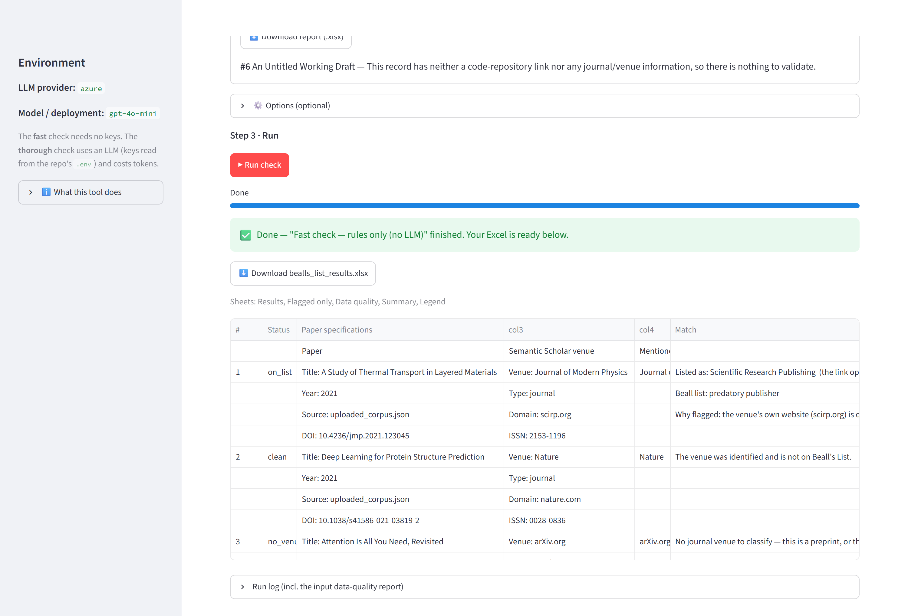
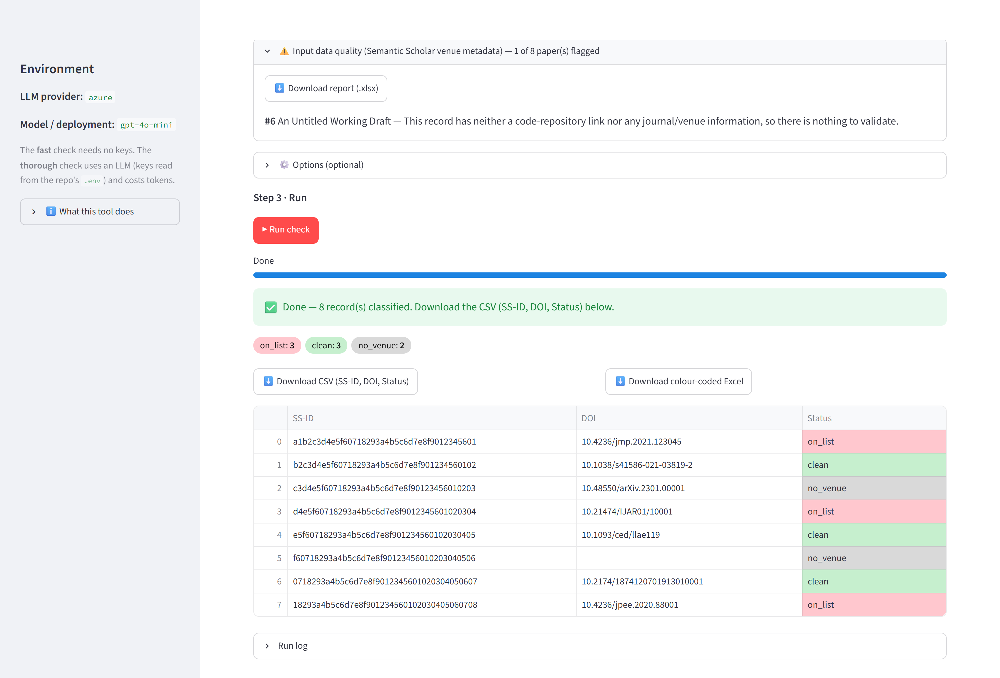

# The web app

> Deep-dive companion to [`app.py`](app.py) and [`runners.py`](runners.py). The
> main [README](../README.md) gives the short version and links here.
> For how a verdict is reached, see [`match/`](../src/bealls_list_check/match/README.md)
> and [`resolve/`](../src/bealls_list_check/resolve/README.md).

A [Streamlit](https://streamlit.io) front end for the same scripts the command
line runs. It is intended for **local, single-user** use — it is not a server,
has no authentication, and writes to the same results folder as the CLI.

```powershell
.\run_ui.ps1       # from the repo root; macOS/Linux: bash ./run_ui.sh
```

The launcher verifies that `.venv` exists (run [`setup.ps1`](../setup.ps1) first
if not), installs Streamlit into it on first use, and starts the app. Neither
launcher pins a port, so use the URL printed in the terminal: `8501` unless it is
taken, in which case Streamlit selects the next free port.


## The three checks

Selected in Step 1. All three run the same deterministic engine; they differ in
what they add and what they return.

| Check | Runs | Returns | Cost |
|---|---|---|---|
| **Fast check — rules only (no LLM)** | [`bealls_list_check.py`](../src/bealls_list_check/bealls_list_check.py) | `bealls_list_results.xlsx` — the full five-sheet workbook | none |
| **Thorough check — rules + LLM over the review papers** | [`bealls_llm_check.py`](../src/bealls_list_check/bealls_llm_check.py) | `bealls_llm_results.xlsx` — the same workbook plus an **LLM review** column on *Flagged only* | tokens; requires keys in `.env` |
| **Batch CSV — SS-ID, DOI, Status** | [`batch_check.py`](../src/bealls_list_check/batch_check/batch_check.py) | `bealls_status.csv` **and** a colour-coded `bealls_status.xlsx` | none |

The sidebar shows which LLM provider and model are configured, and a short
reminder that only the thorough check needs them.

## The page, step by step

### Step 1 · Choose a check

The dropdown is followed by a one-line description of what that check answers and
a badge stating whether it uses an LLM.

### Step 2 · Provide the papers

Semantic Scholar **paper records**, either uploaded as a `.json` file or pasted
into a text box. An expander shows the expected shape. Accepted input:

- a **JSON list** of paper objects, or
- a **single** paper object (it is wrapped into a list automatically).

Anything else is rejected with a message rather than a traceback. **`.jsonl` is
not accepted** — convert it to an array first, or use `batch_check.py` on the
command line, which reads `.jsonl`, `.ndjson` and `.json`. Streamlit's upload
limit is 200 MB per file.

#### The input data-quality panel

As soon as papers load, an **Input data quality** panel reports how many of them
have suspect Semantic Scholar metadata — computed offline, in-process, *before*
any check runs, so problems surface before tokens or minutes are spent. The first
five are listed inline; the **Download report (.xlsx)** button produces
`input_data_quality.xlsx` with **one row per paper**, reading `OK` where there is
nothing to report.

This panel runs for all three checks — including Batch CSV, whose command-line
form skips input validation entirely.

### Step 3 · Options

Collapsed by default; all optional.

- **Whitelist** — restrict the run to these venues; everything else becomes
  `out_of_scope`.
- **Blacklist** — treat these venues as predatory in addition to Beall's List.
- **Crossref** — a single checkbox, on by default. Clearing it is exactly
  `--crossref off`. It is skipped automatically when there is no internet.

Both venue boxes take the same JSON the CLI flags take as a *file*, pasted
directly:

```json
[{"name": "IEEE", "domain": "ieee.org"}, "Nature"]
```

The format is documented in
[`user_lists/README.md`](../src/bealls_list_check/user_lists/README.md). Neither
box is shown for **Batch CSV**, which classifies every record.

### Step 4 · Run

The **Run check** button stays disabled until papers are loaded. During the run a
progress bar and the latest log line are shown. The bar is a true percentage only
for the thorough check, which prints a `[i/N]` counter per venue; the fast and
batch checks have no per-item counter, so the bar pulses to show the run is
alive. A toast announces the outcome.

## What you get back

### Fast and thorough checks

A success banner, a **download button** for the workbook, and a preview of its
**first sheet, first 40 rows**, with the sheet names listed above it. Below that,
a **Run log** expander holds the check's console output — including the
data-quality report — truncated to the last 8,000 characters, and it opens
automatically when a run fails.



### Batch CSV

Per-status **count chips** in the canonical status colours, then two downloads and
a 100-row preview whose Status cells are shaded to match.

- **`bealls_status.csv`** — the machine-readable `SS-ID, DOI, Status` file, one
  row per input record in input order.
- **`bealls_status.xlsx`** — the same three columns with the status colour
  applied. A CSV cannot carry colour; this is its human-readable twin.



The colours come from `STATUS_FILL_COLORS` in
[`config.py`](../src/bealls_list_check/config.py), so the chips, the preview, the
Excel twin and the main report cannot drift apart.

## Differences from the command line

The most useful table here — the app is not a strict superset of the CLI.

| | Web app | Command line |
|---|---|---|
| `--limit` (cap LLM cost) | **not available** — the thorough check assesses every distinct `review` venue | `bealls_llm_check.py --limit N` |
| Crossref | checkbox: on / off | `--crossref all \| flagged \| off` |
| Whitelist / blacklist | pasted JSON; Fast and Thorough only | file path; also on `bealls_llm_check.py` |
| `.jsonl` input | not accepted | `batch_check.py` only |
| Input data-quality validation | always, for all three checks | main check yes, `batch_check.py` no |
| Record handling | Fast/Thorough deduplicate on `paperId` → `title`; Batch CSV keeps every record | same |

## Limits and gotchas

- **No cancel and no timeout.** A run stops only when it finishes or the launcher
  is stopped; closing the browser tab does not end it.
- **Results are written to one shared folder under a fixed filename**, and the app
  reads back the newest `.xlsx` created since the run started. Two overlapping
  runs — two browser tabs, or the CLI at the same time — can therefore hand one
  session the other's workbook. Run one at a time.
- **The sidebar reads `.env` once, at startup.** Restart the app after editing it.
  The model is always labelled with the `AZURE_OPENAI_DEPLOYMENT` variable name,
  whichever provider is active.
- **The coloured status preview needs pandas**, which arrives as a Streamlit
  dependency rather than a direct requirement; without it the table still renders,
  just without colour.
- **The preview is a preview.** 40 rows of the first sheet (100 for the CSV) —
  download the file for everything else.

## How a run actually works

The checks are **not imported in-process**. They use flat module names
(`config`, `match`, …) that would collide with each other, so
[`runners.py`](runners.py) runs each as a subprocess instead:

1. The uploaded records are written to a temporary corpus directory.
2. `BEALLS_CORPUS_DIR` is set to point at it — **overriding** whatever the
   environment already had.
3. The script is launched with `python -u <script>`, stdout streamed line by line
   so the progress bar can move; the whitelist and blacklist are written to temp
   JSON files and passed as the usual CLI flags.
4. The resulting workbook is read back from `src/bealls_list_check/results/`,
   preferring any `.xlsx` newer than the run's start time — which is what makes
   the locked-file fallback (`…_YYYYMMDD_HHMMSS.xlsx`) work here too.

One visible consequence: the workbook's **"Corpus files"** metadata always reads
`uploaded_corpus.json`, regardless of what the uploaded file was named.

Batch CSV mode follows the same pattern but passes a single input file and `-o`,
and reads back the CSV before the temporary directory is removed.
